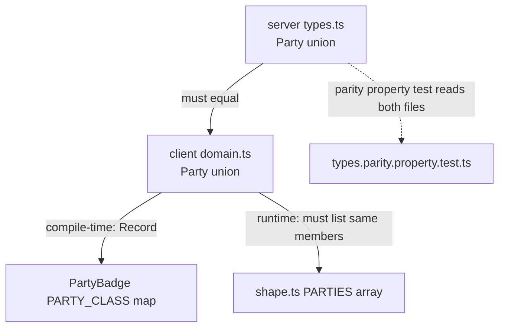

# Design Document

## Overview

This feature expands Easy Elect's curated candidate dataset from the two gubernatorial records it holds today to the full slate of candidates on the official Massachusetts state-election sample ballot (reviewed 2026-10-24), organizes candidates by the race they contest, and surfaces the office each candidate seeks throughout the Voting section.

The work spans four layers that already exist in the codebase:

1. **Dataset** (`server/src/domain/candidates.ts`) — add one `Candidate` record per ballot candidate. New records are *Minimum_Viable_Records*: real identity/office/district/party drawn from the official ballot, with narrative fields left empty rather than invented (Req 5). The two existing researched records (Healey, Minogue) are preserved verbatim, including ids.
2. **Domain types** (`server/src/domain/types.ts` + the client mirror `client/src/types/domain.ts`) — extend the `Party` union with `"Socialism and Liberation"` and `"Unenrolled"`, keeping the two files structurally identical (Req 6, Req 7).
3. **Runtime validator** (`client/src/lib/shape.ts`) — keep the `PARTIES` array in sync with the union so the expanded payload validates (Req 7.4).
4. **Voting UI** (`client/src/features/voting/`) — group the flat candidate grid into race groups ordered deterministically, render the office/district on cards and detail, handle empty bio/stances gracefully, and render every party label with a safe fallback (Req 3, Req 4, Req 5, Req 6).

The design deliberately pushes all testable logic — ballot completeness, record validity, and the list grouping transformation — into pure, data-only functions so they can be property-tested, mirroring the existing `candidates.validity.property.test.ts` and `types.parity.property.test.ts` patterns. The API route layer (`server/src/routes/data.ts`) needs **no change**: it already serves the whole array at `GET /api/candidates` and a single record at `GET /api/candidates/:id`.

### Key design decisions

- **Grouping lives in a pure client helper, not in the component.** `CandidatesList.tsx` currently builds a flat `filtered` array inline. We extract a pure function `groupCandidatesByRace(candidates, { query, party })` into `client/src/lib/` so the deterministic ordering and partition-by-office+district logic are unit- and property-testable in isolation, independent of React. (Req 3.1–3.7)
- **Stance-less candidates are a first-class, valid state** rather than an error. The Minimum_Viable_Record is the normal shape for an unresearched candidate; the UI renders "positions not yet available" and an empty biography area with no fabricated text. (Req 5)
- **The dataset is the single source of truth; the race grouping is derived, never stored.** No `race` field is added to `Candidate`; a race is defined entirely by equal `office` + `district`. This keeps the server shape unchanged and the client/server parity test passing.
- **Quiz scoring is left functionally intact.** `scoreQuiz` already tolerates candidates with no mapped issue values (they score 0 and sort last). Adding stance-less candidates requires no new data and no scoring-logic change; we only document and test the expected behavior.

## Architecture

### Data flow

```mermaid
flowchart LR
  DS["candidates.ts\n(Candidate[] source of truth)"] -->|GET /api/candidates| API["data.ts route\n(unchanged)"]
  API -->|JSON array| V["shape.ts\nvalidateCandidateList"]
  V -->|ShapeResult: valid| G["lib/raceGroups.ts\ngroupCandidatesByRace(candidates, filters)"]
  G -->|RaceGroup[] ordered| LIST["CandidatesList.tsx\nrender groups + headings"]
  V -->|validateCandidate| DETAIL["CandidateDetail.tsx\noffice/district, bio, stances"]
  LIST --> BADGE["PartyBadge.tsx\nlabel per Party + fallback"]
  DETAIL --> BADGE
```

### Type-sync and validation chain

The `Party` union is declared in two places and consumed in a third. A change must propagate through all three in the same edit or the system breaks in a detectable way:



- A new `Party` member that is **not** added to `PartyBadge`'s `Record<Party, string>` map is a **compile error** (TypeScript requires every union member as a key). This is a desirable guard, not a hazard — it forces the badge to be updated. (Req 6.5)
- A new `Party` member that is **not** added to `shape.ts`'s `PARTIES` array is a **runtime rejection**: `validateCandidate` would classify any candidate with the new party as invalid and the Voting UI would surface a type-mismatch error instead of rendering. So `PARTIES` must be updated in the same change. (Req 7.4)
- The existing `types.parity.property.test.ts` reads both files and compares interface field descriptors; it already guards the interface shapes. The `Party` union is a type alias (not an interface) so it is not covered by that test — we add an explicit party-union parity test (see Testing Strategy).

### Request flow for a single candidate

`GET /api/candidates/:id` resolves by `candidates.find((c) => c.id === req.params.id)`. Every new record must therefore carry a **URL-safe** `id` (lowercase kebab-case derived from the candidate name, e.g. `edward-markey`, `shiva-ayyadurai`). This is a constraint on the dataset, not a route change. (Req 1.4)

## Components and Interfaces

### 1. Dataset: `server/src/domain/candidates.ts`

Append one `Candidate` record per ballot candidate not already present. The two existing records stay byte-for-byte unchanged (same ids `maura-healey`, `mike-minogue`, same researched content). The complete roster the dataset must contain, by race:

| Office | District | Candidates (party) |
|---|---|---|
| Senator in Congress | Massachusetts | Edward J. Markey (Democratic), John Deaton (Republican), Shiva Ayyadurai (Independent), Joe Tache (Socialism and Liberation) |
| Governor | Massachusetts | Maura Healey (Democratic, existing), Mike Minogue (Republican, existing), Donnelly James (Independent, NEW) |
| Attorney General | Massachusetts | Andrea Joy Campbell (Democratic), Michael C. Walsh (Republican) |
| Secretary of State | Massachusetts | William Francis Galvin (Democratic), Anne R. Brensley (Republican) |
| Treasurer | Massachusetts | Deborah B. Goldberg (Democratic), Elizabeth Dionne (Republican) |
| Auditor | Massachusetts | Diana DiZoglio (Democratic), Al Ozonoff (Libertarian) |
| Representative in Congress | Second District | James P. McGovern (Democratic) |
| Councillor | Eighth District | Tara J. Jacobs (Democratic) |
| Senator in General Court | Hampshire, Franklin & Worcester District | Joanne M. Comerford (Democratic) |
| Representative in General Court | First Franklin District | Lora L. Wondolowski (Democratic), Amy E. LaVallee (Unenrolled) |
| District Attorney | Northwestern District | David E. Sullivan (Democratic) |
| Register of Probate | Franklin County | Daniel Francis Graves (Democratic) |
| Sheriff (Vacancy) | Franklin County | Lori M. Streeter (Democratic), Gary Edward Gagnon (Independent), Jon J. Hall (Unenrolled) |
| Council of Governments Executive Committee | Franklin County | Jane M. Peirce (Unenrolled) |

Notes that bind the dataset to the requirements:
- The Governor/Lieutenant Governor ticket is represented as **one** record per ticket (Req 1.3). Healey and Minogue are existing single records; the Independent James/Kittredge ticket becomes one new record (name = the printed candidate name for the office, consistent with how the existing records name only the gubernatorial candidate).
- `office` and `district` within a race are **byte-for-byte identical** across all records in that race (Req 2.4) — the grouping relies on this but also normalizes defensively (see helper below).
- Where the ballot names no district qualifier for a statewide race, `district` is the exact string `"Massachusetts"` (Req 2.3).
- `source` on every new record = `{ name: <official ballot publisher name>, url: <Official_Ballot_Source>, reviewedOn: "2026-10-24" }` (Req 5.3).
- `website` and `handle` are **omitted** on records with no verified value (Req 5.4, 5.5).
- `candidatesById` continues to be derived with `new Map(candidates.map((c) => [c.id, c]))`; no change to its construction.

### 2. Dataset completeness/validity check

A pure, exported helper (co-located with the dataset or in a small `candidates.validation.ts`) backs the completeness test:

```ts
/** The canonical ballot roster: name + office + district + party, from the
 *  Official_Ballot_Source (reviewed 2026-10-24). The single source the
 *  completeness test checks the dataset against. */
export interface BallotEntry {
  name: string;
  office: string;
  district: string;
  party: Party;
}
export const OFFICIAL_BALLOT_ROSTER: readonly BallotEntry[];

/** Result of checking the dataset against the official ballot roster. */
export interface DatasetCompleteness {
  complete: boolean;
  /** Ballot names with no matching Candidate_Record (Req 1.6). */
  missing: string[];
  /** Record names not present on the official ballot (Req 1.1). */
  extra: string[];
}
export function checkDatasetCompleteness(
  dataset: Candidate[],
  roster?: readonly BallotEntry[],
): DatasetCompleteness;
```

`checkDatasetCompleteness` matches dataset records to roster entries by `name` and reports both directions: any ballot name with no record (dataset incomplete → rejected, naming the missing candidate, Req 1.6) and any record whose name is not on the ballot (Req 1.1). The existing `candidates.test.ts` size/uniqueness checks and `candidates.validity.property.test.ts` structural checks remain and are extended.

### 3. Grouping helper: `client/src/lib/raceGroups.ts` (new, pure)

```ts
import type { Candidate, Party } from "../types/domain";

export interface RaceGroup {
  /** Display office (verbatim from the first candidate in the group). */
  office: string;
  /** Display district (verbatim from the first candidate in the group). */
  district: string;
  /** Candidates in the race, ordered case-insensitively by name. */
  candidates: Candidate[];
}

export interface RaceFilters {
  /** Free-text search over name/office/party/district (case-insensitive). */
  query: string;
  /** "all" or a specific Party. */
  party: "all" | Party;
}

/**
 * Partition candidates into race groups keyed by office+district (compared
 * case-insensitively after trimming), apply the active filters, and return the
 * groups in deterministic order. Groups with no surviving candidate after
 * filtering are dropped. Pure: no React, no I/O. (Req 3.1–3.7)
 */
export function groupCandidatesByRace(
  candidates: Candidate[],
  filters: RaceFilters,
): RaceGroup[];
```

Algorithm:
1. **Filter** each candidate by both the party filter (`party === "all" || c.party === party`) and the query (same fields the current component checks: name, office, party, district; case-insensitive `includes`). A candidate must pass **both** to survive (Req 3.4–3.6).
2. **Key** each surviving candidate by `normalize(office) + "\u0000" + normalize(district)` where `normalize(s) = s.trim().toLowerCase()`. Using a NUL separator avoids collisions between e.g. `("ab","c")` and `("a","bc")` (Req 3.1).
3. **Within a group**, sort candidates case-insensitively ascending by `name` (Req 3.2).
4. **Across groups**, sort by normalized office ascending, then normalized district ascending (Req 3.2).
5. Each `RaceGroup` carries the verbatim `office`/`district` of its first (post-sort) member for the heading — the display strings are not normalized, only the grouping key is (Req 3.3, Req 4.1).
6. If no candidate survives, return `[]`; the component renders the empty state (Req 3.7).

### 4. `CandidatesList.tsx` changes

Replace the flat `filtered` grid with grouped rendering driven by the helper:

- Compute `const groups = useMemo(() => groupCandidatesByRace(state.data ?? [], { query, party }), [state.data, query, party]);`
- The party-filter `<select>` still derives its options from the full dataset (unchanged).
- Inside `AsyncContent`: if `groups.length === 0` render the existing empty-state card ("No candidates match the current filters", Req 3.7). Otherwise render each group as a `<section>` with an `<h2>`/`<h3>` heading showing both office and district (e.g. `"{office} · {district}"`, Req 3.3), followed by the existing card grid for `group.candidates`.
- Each card is unchanged except that the office label uses the guarded render (see Error Handling / Req 4.4): `{office} · {district}` only when `office` is a non-empty string; otherwise show district alone with no office label and no error.
- Card still renders `PartyBadge`, name, tagline, `FollowButton`, and the Following badge.

New CSS in `Voting.module.css`: a `.raceGroup` wrapper and `.raceHeading` style; reuse the existing `.grid`, `.candidateCard`, `.office` classes.

### 5. `CandidateDetail.tsx` changes

- Office/district already render as `{c.office} · {c.district}`; guard the office the same way (Req 4.2, 4.3, 4.4): when `office` is empty, render district only, no office label, no error.
- **Empty stances** (`c.stances.length === 0`): render a message such as "Positions are not yet available for this candidate." in the Positions section instead of mapping an empty array (Req 5.6).
- **Empty bio** (`bio.simple === "" && bio.expert === ""`): the `Explainer` already renders whatever string it is given; for the empty-string case it renders zero characters. We ensure no placeholder/fallback copy is substituted so the biography area shows no fabricated text (Req 5.7). The source-attribution line still renders (the new records have a real `source`).
- `website` is optional and already guarded by `c.website && (...)`; omitted-website records render no campaign link (Req 5.4).

### 6. `PartyBadge.tsx` + `PartyBadge.module.css` changes

Extend the class map and add a safe fallback for unknown values:

```ts
const PARTY_CLASS: Record<Party, string> = {
  Democratic: styles.dem,
  Republican: styles.rep,
  "Green-Rainbow": styles.green,
  Libertarian: styles.lib,
  Independent: styles.ind,
  Nonpartisan: styles.ind,
  "Socialism and Liberation": styles.psl,
  Unenrolled: styles.ind,
};

export default function PartyBadge({ party }: { party: Party }) {
  const className = PARTY_CLASS[party] ?? styles.ind; // fallback for unknown (Req 6.6)
  const label = typeof party === "string" && party.length > 0 ? party : "Unknown";
  return <span className={`${styles.badge} ${className}`}>{label}</span>;
}
```

- Every `Party` member — including the two new ones — maps to a visible class, so every member renders a visible label (Req 6.5).
- The `?? styles.ind` fallback and the `label` guard mean a value outside the union (which can only arrive as unvalidated data, since validation would reject it) still renders a badge without throwing (Req 6.6).
- New CSS class `.psl` for "Socialism and Liberation" (a distinct color); `Unenrolled` reuses the neutral `.ind` styling. Both get `[data-theme="dark"]` variants consistent with the existing badges.

### 7. Type + validator sync

- `server/src/domain/types.ts`: `Party` union gains `| "Socialism and Liberation" | "Unenrolled"`.
- `client/src/types/domain.ts`: identical edit, same member order (Req 7.1, 7.2).
- `client/src/lib/shape.ts`: `PARTIES` array gains the same two string literals so `validateCandidate` accepts them (Req 7.4).

## Data Models

### Minimum_Viable_Record

A new candidate with no researched narrative content takes this exact shape (example, Independent gubernatorial ticket):

```ts
{
  id: "donnelly-james",              // non-empty, unique, URL-safe (Req 1.4)
  name: "Donnelly James",            // verbatim ballot name (Req 1.5)
  party: "Independent",              // a Party_Type member (Req 6.3)
  office: "Governor",                // non-empty, 1–120 chars (Req 2.1)
  district: "Massachusetts",         // non-empty, 1–120 chars (Req 2.2, 2.3)
  tagline: "",                       // no fabricated slogan
  bio: { simple: "", expert: "" },   // empty, not invented (Req 5.2)
  stances: [],                       // empty list (Req 5.1)
  source: {                          // Official_Ballot_Source (Req 5.3)
    name: "Massachusetts Secretary of the Commonwealth — Sample Ballot",
    url: "https://www.sec.state.ma.us/WhereDoIVoteMA/ShowBallot/ViewMyBallot/BallotOut/ST/154/0/1?ipid=promo-link-block1",
    reviewedOn: "2026-10-24",
  },
  // website omitted (Req 5.4)
  // handle omitted (Req 5.5)
}
```

The `Candidate`, `CandidateStance`, and `SourceAttribution` interfaces are **unchanged** — the Minimum_Viable_Record is a populated instance of the existing shape, which is why no interface edit is needed and the parity test keeps passing (Req 7.3).

### Party union additions

```ts
export type Party =
  | "Democratic"
  | "Republican"
  | "Independent"
  | "Libertarian"
  | "Green-Rainbow"
  | "Nonpartisan"
  | "Socialism and Liberation"   // NEW (Req 6.1)
  | "Unenrolled";                // NEW (Req 6.2)
```

Both values are distinct string literals not equal to any existing member (Req 6.1, 6.2). The server and client declarations list the identical, equal-length member set (Req 7.1, 7.2), and `shape.ts`'s `PARTIES` array mirrors it (Req 7.4).

### Race grouping (derived, not stored)

A race is not a stored entity; it is the equivalence class of candidates sharing a normalized `(office, district)` key. `RaceGroup` (defined above) is the in-memory projection produced by `groupCandidatesByRace`, consumed only by the view.

## Correctness Properties

*A property is a characteristic or behavior that should hold true across all valid executions of a system — essentially, a formal statement about what the system should do. Properties serve as the bridge between human-readable specifications and machine-verifiable correctness guarantees.*

This feature has a clear pure-logic core — the dataset (a fixed array checked against a fixed roster) and the `groupCandidatesByRace` transformation (a pure function over generated candidate lists and filters) — which is well-suited to property-based testing. UI rendering concerns (headings, the empty-state message, badge colors) are covered by example/component tests in the Testing Strategy, not by properties.

### Property 1: Grouping partitions candidates exactly by race

For any list of candidates and the no-op filter (`query: ""`, `party: "all"`), the multiset of candidates across all returned `RaceGroup`s equals the input multiset, and within each group every candidate shares the same normalized `(office, district)` key while candidates in different groups have different keys.

**Validates: Requirements 3.1**

### Property 2: Grouping output is deterministically ordered

For any list of candidates and any filters, the returned groups are sorted ascending (case-insensitive) by normalized office then normalized district, and within each group the candidates are sorted ascending (case-insensitive) by name.

**Validates: Requirements 3.2**

### Property 3: Filters never surface a non-matching candidate

For any list of candidates and any filters, every candidate appearing in any returned group satisfies **both** the party filter (party equals the selected party, or the selected party is "all") and the query filter (name, office, party, or district contains the query text, case-insensitive); and no candidate that satisfies both filters is omitted.

**Validates: Requirements 3.4, 3.5, 3.6**

### Property 4: Empty result yields no groups

For any list of candidates and any filters under which no candidate satisfies both filters, `groupCandidatesByRace` returns an empty list of groups.

**Validates: Requirements 3.7**

### Property 5: Group headings preserve verbatim office and district

For any returned `RaceGroup`, its `office` and `district` display strings are byte-for-byte equal to the `office` and `district` of some candidate in that group (no normalization, truncation, or transformation applied to the displayed values).

**Validates: Requirements 3.3, 4.1**

### Property 6: Every ballot candidate is present in the dataset

For any entry in the `OFFICIAL_BALLOT_ROSTER`, there exists exactly one `Candidate_Record` in the dataset whose `name` equals that entry's name; equivalently, `checkDatasetCompleteness(candidates).complete` is true with empty `missing` and `extra` lists.

**Validates: Requirements 1.1, 1.6**

### Property 7: Every candidate record is structurally valid

For any candidate drawn from the dataset, the record has a non-empty unique `id`, a `party` that is a member of the `Party` union, non-empty `office` and `district` within 1–120 characters, a `source` whose `url` equals the Official_Ballot_Source for Minimum_Viable_Records (or a valid HTTP/HTTPS URL for researched records), and `reviewedOn === "2026-10-24"`.

**Validates: Requirements 1.4, 2.1, 2.2, 5.3**

### Property 8: Minimum_Viable_Records carry no fabricated content

For any candidate record whose `source.url` equals the Official_Ballot_Source (i.e. a Minimum_Viable_Record), its `stances` list is empty, both `bio.simple` and `bio.expert` are empty strings, and neither `website` nor `handle` is present.

**Validates: Requirements 5.1, 5.2, 5.4, 5.5**

### Property 9: Same-race records share identical office and district

For any two candidate records that are placed in the same race group, their raw `office` values are equal and their raw `district` values are equal.

**Validates: Requirements 2.4**

### Property 10: Party values are all in the union and client-accepted

For any candidate in the dataset, its `party` is a member of the `Party` union and is present in `shape.ts`'s `PARTIES` array, so `validateCandidateList(candidates)` returns a valid result preserving record count and order.

**Validates: Requirements 6.3, 7.1, 7.4**

## Error Handling

| Condition | Layer | Behavior | Requirement |
|---|---|---|---|
| New `Party` member missing from `PartyBadge` map | Compile time | TypeScript error on `Record<Party, string>` — build fails until fixed | 6.5 |
| New `Party` member missing from `PARTIES` array | Runtime (client) | `validateCandidate` returns `{ valid: false }`; Voting UI shows the type-mismatch error rather than rendering | 7.4, 7.5 |
| `party` value outside the union reaches the badge | Runtime (client) | `PARTY_CLASS[party] ?? styles.ind` renders a neutral fallback badge; label falls back to "Unknown" if non-string/empty — no throw | 6.6 |
| `office` absent or empty on a record | Runtime (client) | Card/detail render district only, no office label, no error | 4.4 |
| `stances` empty | Runtime (client) | Detail view shows "Positions are not yet available for this candidate." | 5.6 |
| `bio.simple` and `bio.expert` both empty | Runtime (client) | Biography area renders zero characters, no placeholder/fabricated text | 5.7 |
| Ballot candidate missing from dataset | Build/test time | `checkDatasetCompleteness` reports `complete: false` with the missing name in `missing[]`; completeness test fails | 1.6 |
| Record whose `office` is missing on the ballot | Build/test time | Treated as a dataset defect: completeness/validity test fails identifying the record; such a record is not added | 2.5 |
| Candidate affiliation matches no `Party` member | Build/test time | The record is not added; validity test rejects any dataset record with an out-of-union party | 6.4 |
| Server/client `Party` unions drift apart | Test time | Party-union parity test fails | 7.1, 7.2 |
| Stance-less candidate scored by the quiz | Runtime (server) | `scoreQuiz` finds no shared issues → score 0, sorted last; no new data required, no crash | (side effect of Req 5) |

### Quiz scoring side effect

`scoreQuiz` looks up each candidate in `candidateIssueValues`. New candidates have no entry there, so `issueValues` defaults to `{}`, `shared` stays 0, and `score` is 0. The sort places score-0 candidates after any candidate with a positive score, breaking ties by `sharedIssues` then `id`. This is the correct and intended behavior for unresearched candidates — they cannot be matched on issues they have no recorded position on — and it requires no change to `quizScoring.ts`. A regression test pins this so future dataset growth does not silently alter match ordering for the researched candidates.

## Testing Strategy

The feature is tested with a dual approach: property-based tests for the pure dataset/grouping logic (minimum 100 iterations each, using `fast-check`, the library already in use), and example/component tests for UI behavior and configuration.

### Property-based tests (server, `fast-check`)

Co-located with the dataset, extending the existing `candidates.validity.property.test.ts` and `candidates.test.ts`:

- **Property 6** — dataset completeness: `checkDatasetCompleteness(candidates)` is complete with empty `missing`/`extra`. Tagged: `Feature: all-ballot-candidates-by-office, Property 6`.
- **Property 7** — record structural validity over `fc.constantFrom(...candidates)`: id/party/office/district/source/reviewedOn invariants.
- **Property 8** — Minimum_Viable_Record emptiness: for records whose `source.url` is the Official_Ballot_Source, empty stances/bio and absent website/handle.
- **Property 10** — every `party` is in the union (reuse the existing validity test's `PARTY_SET`, extended with the two new members).

### Property-based tests (client, `fast-check`)

New `client/src/lib/raceGroups.property.test.ts`, driven by a `fast-check` arbitrary that generates `Candidate[]` with varied office/district/party/name (including whitespace and case variants to exercise normalization) and random `RaceFilters`:

- **Property 1** — partition exactness (multiset preservation + intra/inter-group key agreement).
- **Property 2** — deterministic ordering of groups and intra-group candidates.
- **Property 3** — filter soundness and completeness (no non-matching candidate surfaced; no matching candidate dropped).
- **Property 4** — empty result → empty groups.
- **Property 5** — headings preserve verbatim office/district.
- **Property 9** — same-group records share raw office/district.

Each test is tagged `Feature: all-ballot-candidates-by-office, Property N: <text>` and runs `numRuns: 100`.

### Parity test (extend existing)

Add a party-union parity check (a new `it` in `types.parity.property.test.ts` or a sibling file) that extracts the `Party` union members from both `server/src/domain/types.ts` and `client/src/types/domain.ts` and asserts identical, equal-length member sets (Req 7.1, 7.2). A companion assertion checks that `shape.ts`'s `PARTIES` array equals the client union member set (Req 7.4).

### Example / component tests (client, Testing Library)

- `CandidatesList`: renders a heading per race group containing both office and district; with a party filter active, only matching groups/candidates appear; with no matches, the empty-state message renders (Req 3.3, 3.5, 3.7).
- `CandidateDetail`: a stance-less record shows the "positions not yet available" message (Req 5.6); an empty-bio record renders no biography text and no placeholder (Req 5.7); a record with empty office renders district only (Req 4.4).
- `PartyBadge`: renders a visible label for each `Party` member including the two new ones (Req 6.5); an out-of-union value renders a fallback badge without throwing (Req 6.6).

### Regression test (server)

- `quizScoring`: with the expanded roster, researched candidates (Healey, Minogue) retain their scores and ranking for a fixed answer set, and stance-less candidates score 0 and rank last (documents the Req 5 side effect).

### Why not property-test everything

Per the PBT guidance, UI rendering (headings, the empty-state copy, badge colors, biography suppression) is behavior that does not vary meaningfully across a large generated input space and is best covered by targeted example tests. The dataset completeness check runs once over a fixed array; it is a property only in the trivial "for any ballot entry" sense, which the single completeness assertion captures. Everything with a genuine "for all inputs" character — the grouping transformation and per-record invariants — is property-tested above.
