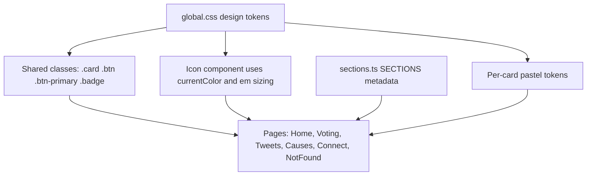
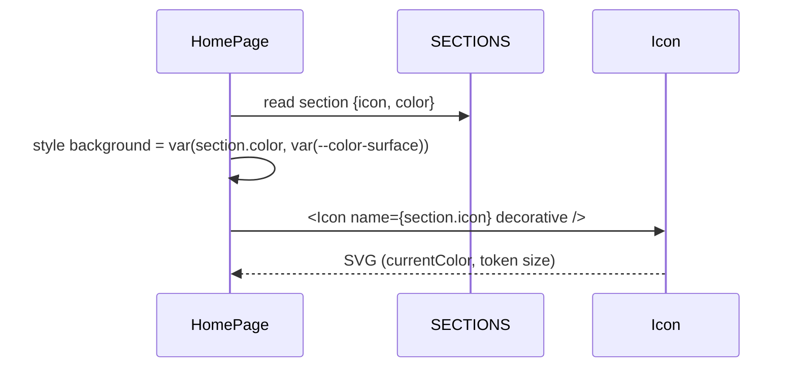

# Design Document

## Overview

This is a presentation-only redesign of the Easy Elect client. It delivers a calm, minimalist look — a soft pastel palette, generous token-driven spacing, clean typography, consistently rounded buttons, and inline SVG icons in place of emoji — without touching any route, data flow, or feature behavior.

The design leans entirely on the existing architecture: CSS custom properties in `client/src/styles/global.css` and the shared `.card`, `.btn`, `.btn-primary`, and `.badge` classes. The core strategy is **token-first**: change token values and shared classes once, and every page that already consumes tokens inherits the new look. The only structural (non-token) changes are:

1. A small, strongly-typed inline **SVG Icon system** that replaces emoji glyphs.
2. An optional `color` field on `SECTIONS` metadata that names a per-card pastel token.
3. A refined home-page card grid for equal columns and defined responsive breakpoints.

Everything else is a token value change (palette, radii already exist) or a class refinement.

### Goals

- Soft pastel light and dark palettes that meet WCAG contrast floors (4.5:1 body text, 3:1 focus).
- Per-card pastel coloring for the four home sections, carried by metadata + tokens (no literals in markup).
- An evenly-spaced, responsive home grid (4 cols ≥1024px, 2 cols 640–1023px, 1 col <640px).
- Vector icons everywhere emoji are used today, with correct decorative/interactive ARIA treatment.
- One shared styling source per element type (card, button, header, icon).
- The existing Vitest suite stays green; no behavioral or routing change.

### Non-Goals

- No new routes, pages, data fetching, or feature logic.
- No component API changes beyond the `PageHeader` icon prop type and the `SectionMeta.icon` type.
- No heavy runtime dependency (see "Icon approach" in Architecture for the tradeoff decision).

### Research Notes

- **Contrast math.** WCAG 2.x contrast ratio is `(L1 + 0.05) / (L2 + 0.05)` where `L` is relative luminance computed from linearized sRGB channels ([W3C WCAG relative luminance definition](https://www.w3.org/WAI/GL/wiki/Relative_luminance), [W3C contrast ratio definition](https://www.w3.org/TR/WCAG21/#dfn-contrast-ratio)). All target values below were chosen against this formula. Content was rephrased for compliance with licensing restrictions.
- **Icon dependency tradeoff.** The team keeps the app dependency-light (only `react`, `react-dom`, `react-router-dom`; the `sections.ts` comment notes "emoji keeps the MVP dependency-light"). A full icon package such as `lucide-react` ships hundreds of icons and a component layer; this app needs roughly eight glyphs. The design therefore uses **local inline SVG components** — zero runtime dependency, full control over sizing/color via tokens, and tree-shakeable. The tradeoff (hand-authoring a handful of `<path>` definitions vs. importing a library) is small and one-time. See the Architecture decision record below for the rejected alternative.
- **No gradients.** Requirement 1.4 forbids multi-stop gradients for primary/accent; all palette tokens are single solid colors, consistent with the current token file which already uses solid hex values.

## Architecture

### Layering (unchanged)



Tokens sit at the base. Shared classes and the Icon component consume tokens. Pages consume shared classes, the Icon component, and `SECTIONS` metadata. Theme switching remains a single `[data-theme]` attribute flip on `<html>` driven by the existing `SettingsContext`/`ThemeProvider`.

### Decision record: Icon approach

**Decision:** Add a local, strongly-typed inline SVG `Icon` component under `client/src/components/icons/`. No runtime dependency.

**Rationale:** The surface needs ~8 glyphs (four sections, page header per section, brand mark, theme sun/moon, chatbot, tweet like/repost, plus a fallback). Inline SVG lets each icon:
- inherit color via `fill="currentColor"`/`stroke="currentColor"` so it references `--color-*` tokens through CSS `color` (Req 4.10);
- size uniformly via a single `size` prop mapped to an em/rem value (Req 4.9);
- carry correct ARIA (`aria-hidden` when decorative, labeled by its control when interactive — Req 4.7, 4.8).

**Rejected alternative:** `lucide-react` (would be pinned to `0.544.0` if chosen). Rejected because it adds a runtime dependency and a dependency-update surface for a handful of glyphs, conflicting with the team's dependency-light stance. If the icon count grows substantially later, revisiting `lucide-react` at a pinned version is reasonable; it is not justified now.

### Icon system shape

A single `Icon` component renders one of a closed set of named glyphs:

```ts
// client/src/components/icons/types.ts
export type IconName =
  | "voting"      // ballot box  (section Voting, page header)
  | "tweets"      // chat bubble (section Tweets)
  | "causes"      // target      (section Causes)
  | "connect"     // handshake   (section Connect)
  | "brand"       // brand mark (ballot)
  | "sun"         // light theme indicator
  | "moon"        // dark theme indicator
  | "chat"        // chatbot launcher
  | "like"        // tweet like (heart)
  | "repost"      // tweet repost
  | "info"        // "added context" marker
  | "fallback";   // placeholder when a name does not resolve
```

```tsx
// client/src/components/icons/Icon.tsx (shape)
import styles from "./Icon.module.css";
import { GLYPHS } from "./glyphs";
import type { IconName } from "./types";

type DecorativeProps = { decorative?: true; label?: never };
type LabeledProps = { decorative: false; label: string };

export type IconProps = {
  name: IconName;
  size?: "sm" | "md" | "lg";   // maps to --icon-size-* tokens
  className?: string;
} & (DecorativeProps | LabeledProps);

export default function Icon({ name, size = "md", decorative = true, label, className }: IconProps) {
  const glyph = GLYPHS[name] ?? GLYPHS.fallback;   // Req 4.11 resolve-or-fallback
  const a11y = decorative
    ? { "aria-hidden": true as const }
    : { role: "img" as const, "aria-label": label };
  return (
    <svg
      viewBox="0 0 24 24"
      className={`${styles.icon} ${styles[size]} ${className ?? ""}`}
      {...a11y}
      focusable="false"
    >
      {glyph}
    </svg>
  );
}
```

Key points:
- `GLYPHS[name] ?? GLYPHS.fallback` guarantees a vector placeholder when a name is unknown, never an emoji or broken image, and the `<svg>` wrapper keeps surrounding layout intact (Req 4.11).
- The discriminated union makes it a **type error** to render a non-decorative icon without a `label`, enforcing Req 4.8 at compile time. Decorative icons are `aria-hidden` (Req 4.7).
- `focusable="false"` avoids a focus stop on the SVG in older engines.

### Per-section icon mapping

`SectionMeta.icon` changes from a free-form emoji `string` to an `IconName`. Pages read `s.icon` and pass it straight to `<Icon name={s.icon} .../>`. Because the home card `Link` carries the accessible name ("Open Voting"), the section icon inside it is decorative.

### Home grid

Replace `repeat(auto-fit, minmax(240px, 1fr))` (which produces unequal trailing columns) with an explicit responsive grid that guarantees equal columns at each breakpoint:

- `≥1024px`: `grid-template-columns: repeat(4, 1fr)` → four equal columns (Req 3.3).
- `640–1023px`: `repeat(2, 1fr)` → two equal columns (Req 3.5).
- `<640px`: `1fr` → single column (Req 3.4).

`1fr` tracks are equal by definition, satisfying the "equal within 1px" criteria (3.1, 3.3, 3.5). A single `gap: var(--space-5)` applies to both axes so horizontal and vertical gaps are equal across all breakpoints (Req 3.2, 3.7), with a non-zero fallback (Req 3.8). Card padding comes from `var(--space-5)` with a fallback (Req 3.6, 3.8).

### Theme fallback strategy

Req 1.8 / 6.6 / 5.7 / 8.7 require that a missing token falls back to a defined value rather than rendering unstyled. CSS `var()` already supports this with its second argument. The design adopts a convention: **wherever a token is consumed in a shared class or a new style, provide the light-theme default as the `var()` fallback**, e.g. `background: var(--color-surface, #ffffff);` and `gap: var(--space-5, 24px);`. This is a mechanical, auditable rule and needs no JS.

## Components and Interfaces

### New

| File | Responsibility |
| --- | --- |
| `client/src/components/icons/types.ts` | `IconName` union and `IconProps`. |
| `client/src/components/icons/glyphs.tsx` | `GLYPHS: Record<IconName, ReactNode>` — the `<path>`/`<g>` body per icon, including `fallback`. |
| `client/src/components/icons/Icon.tsx` | The `Icon` component (sizing, color, ARIA, fallback). |
| `client/src/components/icons/Icon.module.css` | `.icon { width/height from --icon-size-md; color: inherit; }` plus `.sm/.md/.lg`. |

### Changed (interface-affecting)

| File | Change |
| --- | --- |
| `client/src/lib/sections.ts` | `icon: string` → `icon: IconName`; add optional `color?: string` naming a per-card token (e.g. `"--card-voting"`). Emoji literals replaced with icon names. |
| `client/src/components/PageHeader.tsx` | `icon?: string` → `icon?: IconName`; render `<Icon name={icon} decorative />` instead of an emoji span. |

### Changed (style/markup only, no prop changes)

| File | Change |
| --- | --- |
| `client/src/styles/global.css` | New pastel palette for `:root` and `[data-theme="dark"]`; per-card tokens; icon-size tokens; `var(...)` fallbacks on shared classes. |
| `client/src/pages/HomePage.tsx` + `HomePage.module.css` | Render `<Icon>`; apply `s.color` card token via inline `style={{ background: var(--token) }}` sourced from metadata; explicit responsive grid. |
| `client/src/components/Layout.tsx` | Brand mark `<Icon name="brand" decorative />`. |
| `client/src/components/SettingsToggles.tsx` | Theme indicator `<Icon name={theme === "dark" ? "moon" : "sun"} decorative />` (the button already has `aria-label`). |
| `client/src/components/chatbot/Chatbot.tsx` | Launcher `<Icon name="chat" decorative />` (button already labeled); "added context" `info` icon in `TweetCard`. |
| `client/src/features/tweets/TweetCard.tsx` | Like/repost markers `<Icon name="like" .../>` / `name="repost"`; `info` for context label. |
| `client/src/features/voting/FollowButton.module.css` | Confirm radius/padding come from tokens; align with `.btn` pattern. |

### Component interaction (home card)



## Data Models

### SectionMeta (updated)

```ts
import type { IconName } from "../components/icons/types";

export interface SectionMeta {
  id: string;
  path: string;
  title: string;
  tagline: string;
  description: string;
  icon: IconName;      // was: string (emoji)
  color?: string;      // NEW: name of a per-card pastel token, e.g. "--card-voting"
}
```

- `color` holds a **token name**, not a color literal (Req 2.3). The page resolves it with a fallback: `var(section.color, var(--color-surface))`, so an unset or unresolved token degrades to the default card surface with full content (Req 2.4).

### Design tokens (concrete values)

All values below are chosen against the WCAG contrast formula. Ratios are stated so the implementer can verify them with the contrast utility (see Testing Strategy). Hex values carry an HSL annotation where a requirement constrains HSL.

#### Light theme (`:root`)

| Token | Value | Notes / constraint |
| --- | --- | --- |
| `--color-bg` | `#f4f6fb` | base |
| `--color-surface` | `#fbfcff` | bg↔surface ≈ 1.05:1 (Req 1.3: 1.03–1.25) |
| `--color-surface-alt` | `#eaeef6` | surface↔surface-alt ≈ 1.13:1 (Req 1.3) |
| `--color-border` | `#d7deec` | soft border (Req 7.5) |
| `--color-text` | `#232a39` | text↔bg ≈ 13.3:1; text↔surface ≈ 14.0:1 (Req 1.5 ≥4.5) |
| `--color-text-muted` | `#5c6678` | muted↔surface ≈ 5.6:1 |
| `--color-primary` | `#5f7fca` | HSL ≈ (222°, 50%, 58%): S≤60%, L 55–85% (Req 1.1); no gradient (1.4) |
| `--color-primary-contrast` | `#0e1322` | on primary ≈ 4.7:1 (Req 1.7 ≥4.5) — dark ink on pastel primary |
| `--color-primary-soft` | `#dfe6f7` | soft fill for badges/hover |
| `--color-accent` | `#b089d1` | HSL ≈ (272°, 44%, 68%): S≤60%, L 55–85% (Req 1.1) |
| `--color-danger` | `#d4766f` | muted |
| `--color-success` | `#6fb08a` | muted |
| `--color-warning` | `#d0a46b` | muted |

Because `--color-primary` is a light pastel, `--color-primary-contrast` is set to a **dark** ink (`#0e1322`) so text on primary buttons clears 4.5:1 (Req 1.7 ≈4.7:1). This is the key correctness move: a pastel primary cannot carry white text at 4.5:1, so the contrast token flips to dark. The primary lightness (L≈58%) was tuned so the focus outline (which uses `--color-primary`) also clears 3:1 against every light surface — base, surface, surface-alt, and all four pastel card surfaces (3.36–3.81) — not just bg/surface (Req 5.5, 9.5).

#### Dark theme (`[data-theme="dark"]`)

| Token | Value | Notes / constraint |
| --- | --- | --- |
| `--color-bg` | `#12161f` | HSL L ≈ 10% ≤20% (Req 1.2) |
| `--color-surface` | `#191e2a` | HSL L ≈ 13% ≤20% (Req 1.2); bg↔surface ≈ 1.09:1 (Req 1.3) |
| `--color-surface-alt` | `#212736` | surface↔surface-alt ≈ 1.12:1 (Req 1.3) |
| `--color-border` | `#2d3547` | soft border |
| `--color-text` | `#e9edf5` | text↔bg ≈ 15.4:1; text↔surface ≈ 14.2:1 (Req 1.6 ≥4.5) |
| `--color-text-muted` | `#9aa5b8` | muted↔surface ≈ 6.0:1 |
| `--color-primary` | `#8098d6` | HSL ≈ (223°, 51%, 67%): S≤60% (Req 1.2) |
| `--color-primary-contrast` | `#0e1322` | on primary ≈ 6.5:1 (Req 1.7) |
| `--color-primary-soft` | `#26314d` | |
| `--color-accent` | `#b79ad8` | HSL ≈ (268°, 44%, 73%): S≤60% (Req 1.2) |
| `--color-danger` | `#e58e86` | |
| `--color-success` | `#79c79c` | |
| `--color-warning` | `#e0b67e` | |

#### Per-card pastel surface tokens (Req 2.1, 2.5, 2.6)

Four distinct soft pastels per theme. Light values are pale so dark text clears 4.5:1; dark values are deep so light text clears 4.5:1.

| Token | Light | Dark | Section |
| --- | --- | --- | --- |
| `--card-voting` | `#e7eefb` | `#1b2740` | Voting |
| `--card-tweets` | `#e6f3ee` | `#162b26` | Tweets |
| `--card-causes` | `#fbeee6` | `#33241a` | Causes |
| `--card-connect` | `#f1e9f7` | `#271b33` | Connect |

Each of the four resolves to a different value (Req 2.1). Card title uses `--color-text`, tagline uses `--color-primary` or `--color-text`, description uses `--color-text-muted`; against each pastel surface these clear 4.5:1 in light (Req 2.6) and dark (Req 2.5). The tagline color is verified per card in the contrast test; if a pastel tagline color would dip below 4.5:1, the tagline falls back to `--color-text`.

#### Icon size tokens (Req 4.9)

| Token | Value |
| --- | --- |
| `--icon-size-sm` | `1rem` |
| `--icon-size-md` | `1.5rem` |
| `--icon-size-lg` | `2.25rem` |

Icons set `color: inherit` and use `currentColor` for fill/stroke, so they reference whatever `--color-*` token the surrounding text color resolves to (Req 4.10).

#### Radius / spacing / shadow

Existing `--radius-sm/md/lg`, `--space-1..7`, `--shadow-sm/md`, and `--font-sans` are reused unchanged. Buttons use `--radius-sm`; cards use `--radius-md`/`--radius-lg`; the follow pill keeps its `999px` (full-round is a deliberate variant, still token-free of color literals).

## Correctness Properties

*A property is a characteristic or behavior that should hold true across all valid executions of a system — essentially, a formal statement about what the system should do. Properties serve as the bridge between human-readable specifications and machine-verifiable correctness guarantees.*

Here, property-based testing applies to this feature's **pure, value-level core**: the committed design tokens and the small utilities that operate on them (hex→HSL conversion, WCAG contrast, and the `var(name, fallback)` resolve-or-default convention). These have large or open input spaces and well-defined invariants, so running 100+ generated iterations finds bugs that a couple of examples would miss (e.g. a future palette edit that quietly breaks a contrast floor). Layout measurement, icon rendering, ARIA wiring, routing, and theme-flip timing are **not** amenable to PBT under jsdom (no real layout/paint) and are covered by example and integration tests in the Testing Strategy instead.

The tokens are exported from a single typed module (`client/src/styles/tokens.ts`, re-exported into `global.css` values and kept in sync by a parity check) so the property tests read the same values the stylesheet renders.

### Property 1: Pastel HSL bounds hold for constrained color tokens

*For all* theme ∈ {light, dark} and for each token in {`--color-primary`, `--color-accent`} of that theme, converting the token's hex value to HSL yields a saturation of at most 60% and a lightness between 55% and 85% (light theme), and a saturation of at most 60% (dark theme).

**Validates: Requirements 1.1, 1.2**

### Property 2: Dark base surfaces stay dark

*For all* tokens in {`--color-bg`, `--color-surface`} of the dark theme, the HSL lightness is at most 20%.

**Validates: Requirements 1.2**

### Property 3: Adjacent surfaces are softly distinct

*For all* theme ∈ {light, dark} and for each adjacent surface pair in {(`--color-bg`, `--color-surface`), (`--color-surface`, `--color-surface-alt`)}, the WCAG contrast ratio between the pair lies in the closed range [1.03, 1.25].

**Validates: Requirements 1.3**

### Property 4: Primary and accent are single solid colors

*For all* theme ∈ {light, dark} and for each token in {`--color-primary`, `--color-accent`}, the token value parses as a single solid color (hex, `rgb()`, or `hsl()`) and contains no gradient function.

**Validates: Requirements 1.4**

### Property 5: Body and surface text meet the 4.5:1 readability floor

*For all* (textToken, surfaceToken) pairs drawn from the readable-text set — in each theme: (`--color-text`,`--color-bg`), (`--color-text`,`--color-surface`), and for each of the four `--card-*` tokens both (`--color-text`,`--card-*`) and (`--color-text-muted`,`--card-*`) — the WCAG contrast ratio is at least 4.5:1.

**Validates: Requirements 1.5, 1.6, 2.5, 2.6**

### Property 6: Text on primary meets the 4.5:1 floor

*For all* theme ∈ {light, dark}, the WCAG contrast ratio between `--color-primary-contrast` and `--color-primary` is at least 4.5:1.

**Validates: Requirements 1.7**

### Property 7: Missing tokens resolve to a defined non-empty default

*For all* token names in the palette/spacing/radius/typography token set, resolving that name through the `var(name, fallback)` convention when the token is undefined returns the token's defined fallback value, which is non-empty (and, for spacing, non-zero). No usage resolves to an empty or unset value.

**Validates: Requirements 1.8, 3.8, 5.7, 6.6, 8.7**

### Property 8: The four per-card pastel tokens are mutually distinct

*For all* theme ∈ {light, dark}, the four tokens {`--card-voting`, `--card-tweets`, `--card-causes`, `--card-connect`} resolve to four pairwise-different color values.

**Validates: Requirements 2.1**

### Property 9: Section card colors are token references, never literals

*For all* entries in `SECTIONS` that define a `color`, the value is a CSS custom-property reference (matches `/^--/`) and is not a color literal (not hex/`rgb`/`hsl`/named-color).

**Validates: Requirements 2.3**

### Property 10: Styling values are token-sourced, not hardcoded literals

*For all* color, spacing, radius, and shadow declarations in the shared classes, the Icon styles, and the changed page modules, the declared value references a Design_Token via `var(--...)` (optionally with a token/default fallback) and contains no hardcoded color literal, no raw inter-element spacing length, and no non-token radius for the standard button variant. Text color references only `--color-text` or `--color-text-muted`; border color references only `--color-border`.

**Validates: Requirements 2.3, 4.10, 5.1, 5.2, 5.6, 6.4, 7.1, 7.5, 8.2, 8.5, 8.6**

### Property 11: Icon accessibility is correct by role

*For all* `IconName` values: when rendered decoratively the SVG exposes `aria-hidden="true"` and no accessible name; when rendered as the sole content of an interactive control (`decorative={false}`) it exposes a non-empty accessible label via `role="img"` + `aria-label`.

**Validates: Requirements 4.7, 4.8**

### Property 12: Icons of the same size are dimensionally identical

*For all* pairs of `IconName` values rendered with the same `size` prop, both SVGs carry the same size class, which maps to exactly one `--icon-size-*` token; thus any two icons in the same context resolve to identical width and height.

**Validates: Requirements 4.9**

### Property 13: Icon rendering always produces a vector, falling back on unknown names

*For all* name strings (including names outside the `IconName` union), the `Icon` component renders an `<svg>` element — the named glyph when known, otherwise the `fallback` glyph — never an emoji character or a broken-image indicator, and renders without removing adjacent sibling nodes.

**Validates: Requirements 4.11**

### Property 14: Focus outline contrast floor holds on every surface

*For all* theme ∈ {light, dark} and for each surface token the focus outline can appear against — {`--color-bg`, `--color-surface`, `--color-surface-alt`, `--card-voting`, `--card-tweets`, `--card-causes`, `--card-connect`} — the WCAG contrast ratio between `--color-primary` (the focus outline color) and that surface is at least 3:1, and the focus outline thickness is at least 2px.

**Validates: Requirements 5.5, 9.5**

### Property 15: The type scale is monotonically non-increasing and single-valued per level

*For all* adjacent level pairs (level_i, level_{i+1}) in the ordered type scale from the largest heading down to body text, font-size(level_i) ≥ font-size(level_{i+1}); and each level maps to exactly one size value reused across all pages.

**Validates: Requirements 6.5**

### Property 16: Grid gaps are symmetric across every breakpoint

*For all* breakpoint rules of the home card grid, the gap is expressed as a single `gap` value sourced from one `--space-*` token (no asymmetric row/column split), so the horizontal and vertical gaps are equal at every breakpoint.

**Validates: Requirements 3.7**

## Error Handling

This is a presentation-layer feature; "errors" are missing/unresolved tokens and unknown icon names, handled by graceful degradation rather than thrown exceptions.

| Failure | Handling | Requirement |
| --- | --- | --- |
| A palette/spacing/radius/typography token is undefined for the active theme | CSS `var(name, <light-default>)` supplies the light-theme default; nothing renders unset. | 1.8, 6.6 |
| A per-card pastel token is unset or unresolved | Page uses `var(section.color, var(--color-surface))`; card falls back to default surface with all content visible. | 2.4 |
| A spacing token for the grid gap/padding resolves to nothing | `var(--space-5, 24px)` (gap) and `var(--space-5, 24px)` (padding) keep a non-zero separation. | 3.8 |
| A button token (radius/spacing/color) does not resolve | `var(--radius-sm, 6px)`, `var(--space-* , …)`, `var(--color-* , …)` fall back to shared defaults, never a bare literal in a page. | 5.7 |
| An `Icon` is asked for an unknown name | `GLYPHS[name] ?? GLYPHS.fallback` renders the fallback vector; the `<svg>` wrapper preserves layout. | 4.11 |
| A page references a missing token | Same `var(..., default)` convention yields the shared system value; element stays styled. | 8.7 |
| Required theme token missing entirely | Light-theme defaults act as the system baseline (single shared fallback source). | 1.8, 8.7 |

Icons never render as ``, so there is no broken-image state to handle; all glyphs are inline SVG.

## Testing Strategy

The suite stays runnable under the existing stack: Vitest + `@testing-library/react` + jsdom, with `fast-check` for property tests. No new runtime or test dependency is required. Scripts remain `npm run test`, `npm run typecheck`, `npm run build`. Requirement 9.6 (existing tests stay green) is a hard gate: existing tests (`App.test.tsx`, `PostsStatus.test.tsx`, `CausesContext.test.tsx`, `FollowContext.test.tsx`, and the `lib` tests) must keep passing unchanged.

### jsdom limitation and how we work around it

jsdom does not perform real CSS layout or paint, does not resolve the `var()` cascade, and does not compute `:hover`/media-query results. Therefore:

- **Token values** are defined once in a typed module `client/src/styles/tokens.ts` and mirrored into `global.css`. A **parity test** asserts every token in the module appears with the same value in `global.css` (parsed as text), so property tests that read `tokens.ts` are testing the values the stylesheet actually ships.
- **Contrast/HSL** properties run against `tokens.ts` values using a small pure utility `client/src/lib/color.ts` (`hexToHsl`, `relativeLuminance`, `contrastRatio`) implemented from the WCAG definitions.
- **Structural CSS assertions** (equal `1fr` tracks, `gap` token, radius token, no literals, breakpoints) parse the `.module.css`/`global.css` text and assert on the declarations, rather than measuring rendered pixels.
- **Behavior/ARIA** assertions render components with testing-library and assert on roles, accessible names, and presence of `<svg>`.

### Property-based tests (fast-check, ≥100 iterations each)

Each property test is tagged with a comment in the form:
`// Feature: minimalist-visual-redesign, Property {n}: {property text}`
and configured with `{ numRuns: 100 }` (higher where the input set is larger, e.g. the icon-name space).

| Test file | Properties covered |
| --- | --- |
| `client/src/lib/color.test.ts` | P1, P2 (HSL bounds via generated/enumerated tokens), P3 (adjacent-surface band), P5, P6, P14 (contrast floors) — each iterates over the token/pair set and asserts the bound. |
| `client/src/styles/tokens.test.ts` | P4 (solid-color parse, no gradient), P7 (resolve-or-default over the token-name set), P8 (card distinctness), P15 (type-scale monotonic), parity test (tokens.ts ↔ global.css). |
| `client/src/styles/css-invariants.test.ts` | P9 (SECTIONS color is a token ref), P10 (no-literal / token-sourced over parsed style rules), P16 (symmetric gap across breakpoints). |
| `client/src/components/icons/Icon.test.tsx` | P11 (ARIA by role over all `IconName`), P12 (same-size dimensional identity), P13 (any name → svg, unknown → fallback). |

`color.ts` round-trips and contrast computations are the clearest PBT fit: for any token value, `contrastRatio(a,b) === contrastRatio(b,a)` and `contrastRatio(a,a) === 1` are sanity properties, and the requirement floors are asserted over the enumerated token pairs.

### Example and integration tests (testing-library + parsed CSS)

These cover criteria that do not vary meaningfully with generated input or that depend on real layout/behavior.

- **Per-card application (2.2, 2.4):** render `HomePage`; assert each card's inline background references its mapped `--card-*` token, and that a section with `color` undefined falls back to `var(--color-surface)` with title/tagline/description present.
- **Grid breakpoints (3.1–3.6):** parse `HomePage.module.css`; assert `repeat(4,1fr)` ≥1024px, `repeat(2,1fr)` 640–1023px, `1fr` <640px, and `gap`/`padding` reference `--space-*` tokens.
- **Icons replace emoji (4.1–4.6):** render Home, a feature page (`PageHeader`), `Layout` (brand), `SettingsToggles`, `Chatbot`, `TweetCard`; assert an `<svg>` is present at each surface and the previously used emoji codepoints (🗳️ 💬 🎯 🤝 🌙 ☀️ ♥ 🔁 ℹ️) are absent from the DOM text.
- **Icon color sourcing (4.10):** assert `Icon.module.css` sets `color: inherit` and glyphs use `currentColor` (no hex literal).
- **Button consistency (5.3, 5.4):** assert primary buttons across pages all carry `.btn-primary` (single source); assert exactly one hover rule per variant exists in `global.css`.
- **Typography (6.1–6.3):** parse `global.css`; assert `body` uses `var(--font-sans)`, line-height ∈ [1.5, 1.8], and the long-form prose container measures 60–80ch.
- **Spacing rhythm (7.2–7.4):** assert `PageHeader` margin-bottom is one `--space-*` token; stacked-card/group gaps reference one `--space-*` token; `.card` box-shadow references a `--shadow-*` token.
- **Cross-page consistency (8.1, 8.3, 8.4):** assert palette tokens are defined only in `global.css` (no page module redefines `--color-*`); render two pages' `PageHeader` and assert shared structure/classes; toggle theme and assert `documentElement` `data-theme` flips with colors token-driven.
- **Behavior preservation (9.1, 9.2):** extend `App.test.tsx`-style tests to assert every route renders its page and that theme/mode toggles, `FollowButton`, and the chatbot submit still perform their actions.
- **Reduced motion & focus (9.3, 9.4, 9.7):** assert the `prefers-reduced-motion` rule nulls transitions/animations; assert `:focus-visible` outline differs from the unfocused state; assert color-coded states (status, following, like/repost) also carry text or a labeled icon.
- **Suite green + types (9.6):** CI gate runs `npm run test` and `npm run typecheck` with zero failures.

### Unit/property balance

Property tests own the universal, value-level invariants (contrast, HSL, token distinctness, fallback resolution, icon ARIA/fallback) so a single generated test covers the whole input space per property. Example tests own the fixed surfaces, rendering, routing, and CSS-structure checks that jsdom can verify without real layout. Together they cover all testable acceptance criteria while keeping the existing suite green.

## Presentation-Only Guarantee

This feature changes only presentation. It does not add, remove, or alter any route, data fetch, context, or feature behavior. The only non-style code changes are: the `Icon` component and its glyph/type modules (new), the `SectionMeta.icon` type (emoji `string` → `IconName`) plus an optional `color` token field, and the `PageHeader` `icon` prop type (`string` → `IconName`). All page behavior, navigation targets, and interactive control actions are preserved and asserted by the behavior-preservation tests (Req 9.1, 9.2).
