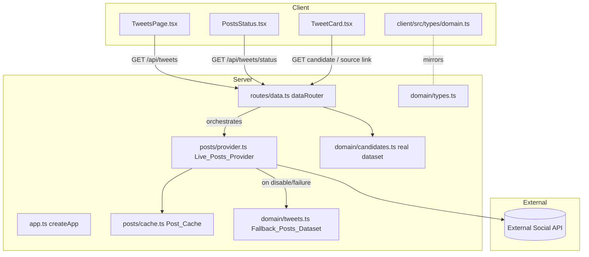
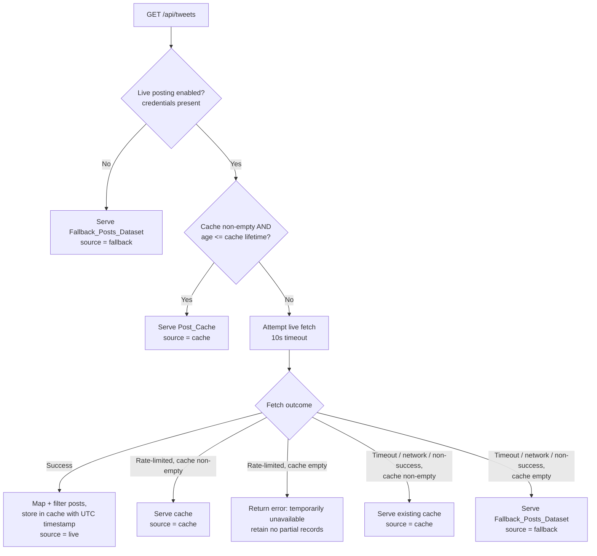

# Design Document

## Overview

This feature replaces Easy Elect's fictional demo content with real, sourced Massachusetts state-election candidate data and adds live social posts fetched from real candidate accounts. It is delivered on the existing monorepo architecture (npm workspaces: `client/` React + Vite, `server/` Node + Express + TypeScript ESM) without introducing new architectural patterns.

The work follows two tracks:

1. **Real candidate data** — the fictional records in `server/src/domain/candidates.ts` and `server/src/domain/tweets.ts` are replaced with a curated, human-verified dataset of real candidates and their actually-proposed stances, each carrying a source URL for attribution, served through the existing read-only `dataRouter`.
2. **Live social posts** — a new server-side `Live_Posts_Provider` module (`server/src/posts/provider.ts`) fetches real posts from an external social API using server-held credentials, with an in-memory time-stamped cache and graceful degradation to a curated fallback dataset. This directly mirrors the existing live-AI / scripted-fallback pattern in `server/src/ai/provider.ts`.

The central design decision is to make the live-posts path mirror the AI path the codebase already uses: `isAiEnabled()` → `isLivePostsEnabled()`; `callOpenAI()` returning `null` on failure so the caller falls back → `fetchLivePosts()` returning `null` so the endpoint falls back; a `source: "ai" | "scripted"` discriminator → a `source: "live" | "cache" | "fallback"` discriminator. Reusing this pattern keeps the surface area small and the behavior predictable, and it keeps credentials strictly server-side exactly as the OpenAI key is handled today.

The most significant ripple is that `GET /api/tweets` changes from returning a bare `Tweet[]` to returning an **envelope** `{ posts: Tweet[]; source: "live" | "cache" | "fallback" }`. That is a breaking response-shape change that touches the shared domain types (Requirement 9), the client consumer (`TweetsPage.tsx`), and the existing `data.test.ts`. This design addresses each of those impacts explicitly.

### Key research findings informing the design

- **X/Twitter API ToS & rate limits (Requirement 11, Requirement 6).** Public social APIs (X/Twitter v2 and equivalents) permit display of *publicly published* posts, require attribution to the author and a link back to the original post, impose per-window rate limits, and prohibit retaining more personal data than needed to render the content. The design therefore: fetches public posts only, stores only `authorName`/`authorHandle`/public post content, attributes every post with a resolvable `sourceUrl`, caches aggressively to stay within rate windows, and documents a removal process/log. The provider is deliberately source-agnostic (an "external social API") so the concrete vendor can be swapped without changing the orchestration.
- **Credential handling.** The existing codebase already proves the pattern: the OpenAI key is read from `process.env` inside the provider module and never serialized. Live credentials follow the same discipline and are documented (name only, empty value) in `server/.env.example`.
- **Caching model.** For this MVP a single-process in-memory cache is sufficient (the server is a single Node process, matching how the AI provider holds no shared state). A time-stamped record with a configurable lifetime satisfies Requirements 6 and 10 without introducing a datastore dependency.

## Architecture

### High-level component map



### Request flow: `GET /api/tweets`

The endpoint orchestrates cache → live → fallback. The decision tree below encodes Requirements 4.7, 6.2, 6.3, 6.4, 6.5, 7.1, 7.2, 7.3, 7.4, 10.2, 10.3, 10.4.



Notes on the flow:

- **Enabled check first (Req 5.4, 7.1).** When credentials are absent the endpoint never attempts a network call; it returns the fallback dataset immediately (well within the 2s bound of Req 7.1).
- **Freshness gate (Req 6.2, 10.3).** A non-empty cache whose age ≤ lifetime is served without any external call.
- **Refresh trigger (Req 6.3, 10.2).** When the cache age exceeds the lifetime (or the cache is empty while enabled), a fresh fetch is attempted before responding.
- **Rate-limit handling (Req 6.4, 6.5).** A rate-limit response serves the most recent cache as a success with `source: "cache"`; if the cache is empty, it returns an error and retains no partial records.
- **Generic failure (Req 7.2, 7.3, 10.4).** Timeout, network error, or any non-success response serves the cache if present (`source: "cache"`), otherwise the fallback (`source: "fallback"`), while leaving the last-successful-fetch timestamp unchanged.
- **Timeout bound (Req 4.6).** The live fetch is wrapped in a 10-second timeout (`AbortController`); exceeding it is treated as a failed fetch and the existing cache is preserved.

### Why this placement

- The provider lives in a new `server/src/posts/` directory, parallel to `server/src/ai/`, so the mirror of the AI pattern is visible in the source tree.
- Orchestration (cache/live/fallback decision) lives in the `dataRouter` handler for `/tweets`, keeping the route as the composition point exactly as `/chat` and `/context` compose provider + scripted fallback in `aiRouter`.
- The cache is its own small module (`server/src/posts/cache.ts`) so its freshness logic is unit-testable in isolation.

## Components and Interfaces

### 1. Live posts provider — `server/src/posts/provider.ts` (new)

Mirrors `server/src/ai/provider.ts`. Reads credentials from `process.env`, uses built-in `fetch` (no SDK), returns structured results or `null`/typed failures so the caller can fall back. Credentials never leave the module.

```ts
import type { Tweet } from "../domain/types.js";

/** Outcome of a live fetch attempt, so the route can decide cache vs fallback. */
export type FetchOutcome =
  | { kind: "ok"; posts: Tweet[] }        // success; posts already mapped + filtered
  | { kind: "rateLimited" }               // external API signalled rate limiting
  | { kind: "failed" };                    // timeout, network error, or non-success

/** True when every required Live_Credentials var is present and non-empty. */
export function isLivePostsEnabled(): boolean;

/**
 * Fetch recent public posts for the configured candidate accounts, map each to
 * a Tweet, and drop any whose author handle matches no candidate. Enforces a
 * 10s timeout via AbortController. Never throws — failures become FetchOutcome.
 */
export function fetchLivePosts(candidates: Candidate[]): Promise<FetchOutcome>;
```

Responsibilities:

- **Enablement (Req 5.1, 5.4):** `isLivePostsEnabled()` = `Boolean(process.env.LIVE_POSTS_BEARER_TOKEN)` (and any other required var), analogous to `isAiEnabled()`.
- **Fetch window (Req 4.1):** request up to the 50 most recent posts within the last 30 days per configured account.
- **Mapping (Req 4.2, 4.4, 11.3):** map each external post to a `Tweet`, setting `candidateId` (via handle match), `sourceUrl` (original post URL), `authorName`, `authorHandle`, `text`, `date` (ISO), engagement counts, and default `tabs`.
- **Handle matching (Req 4.3):** `candidateId` is the candidate whose `handle` matches the post author, compared case-insensitively after stripping a leading `@` (see `normalizeHandle` below).
- **Exclusion (Req 4.5, 11.2, 11.4):** drop posts whose author matches no candidate handle, whose public-publication status is unconfirmed, or that are missing any required attribution field.
- **Timeout (Req 4.6):** `AbortController` with a 10s deadline; abort ⇒ `{ kind: "failed" }`.
- **Rate limit (Req 6.4, 6.5):** HTTP 429 (or documented rate-limit signal) ⇒ `{ kind: "rateLimited" }`.
- **Data minimization (Req 11.5):** only `authorName`, `authorHandle`, and public post content are copied into the `Tweet`; no other personal fields are read or stored.

Shared helper (used by provider and tested directly):

```ts
/** Lowercases and strips a single leading "@". Idempotent. */
export function normalizeHandle(handle: string): string;
```

### 2. Post cache — `server/src/posts/cache.ts` (new)

A single-process, in-memory, time-stamped store. No external datastore (MVP-appropriate, matching the stateless AI provider).

```ts
import type { Tweet } from "../domain/types.js";

export interface CacheEntry {
  posts: Tweet[];
  /** UTC retrieval timestamp (epoch ms). */
  fetchedAt: number;
}

/** Replace cache contents and stamp the retrieval time (UTC). */
export function setCache(posts: Tweet[], now?: number): void;
/** Current cache entry, or null if never populated. */
export function getCache(): CacheEntry | null;
/** True when the cache has one or more posts. */
export function isCacheNonEmpty(): boolean;
/** True when a non-empty cache's age (now - fetchedAt) <= lifetime seconds. */
export function isFresh(lifetimeSeconds: number, now?: number): boolean;
/** Configured lifetime in seconds, clamped to [1, 86400], default 300. */
export function cacheLifetimeSeconds(): number;
```

- **Timestamping (Req 6.1):** `setCache` records `fetchedAt` in UTC epoch ms.
- **Freshness (Req 6.2, 10.3):** `isFresh` returns true only for a non-empty cache within lifetime.
- **Lifetime config (Req 6.6):** `cacheLifetimeSeconds()` reads `EASYELECT_POSTS_CACHE_TTL_SECONDS`, parses it, and returns 300 when unset, non-numeric, or outside `[1, 86400]`.
- The `now?` parameter makes freshness logic deterministic and unit-testable without faking the clock globally.

### 3. Data route changes — `server/src/routes/data.ts`

`GET /tweets` evolves from `res.json(tweets)` into the orchestration described in the request-flow diagram, returning the **envelope** shape.

```ts
import type { TweetsResponse } from "../domain/types.js";

dataRouter.get("/tweets", async (_req, res) => {
  // enabled? -> fresh cache? -> live fetch -> map/filter+cache -> fallback/cache
  const body: TweetsResponse = await resolveTweets();
  res.json(body); // { posts, source }
});
```

A new status endpoint mirrors `GET /ai/status`:

```ts
dataRouter.get("/tweets/status", (_req, res) => {
  res.json({ livePostsEnabled: isLivePostsEnabled() }); // never includes the credential
});
```

The existing candidate endpoints (`GET /candidates`, `GET /candidates/:id` with its 404 `{ error }` body) are unchanged in shape; only the underlying `candidates` data becomes real (Req 1.6–1.8).

### 4. Domain / type changes — `server/src/domain/types.ts`

Two additions, each mirrored into the client within the same change set (Req 9.1).

**(a) Tweets envelope + source indicator (Req 4.7, 7.4).**

```ts
export type PostsSource = "live" | "cache" | "fallback";

export interface TweetsResponse {
  posts: Tweet[];
  source: PostsSource;
}
```

**(b) Source attribution (Req 2.1, 3.1).** The `Candidate` type currently has only `website?`. Requirement 3.1 demands a *source name* plus a *resolvable source URL* for every candidate record, and Requirement 2.1 ties stances to a source. The chosen approach is to **extend the `Candidate` type with a required `source: SourceAttribution` field** and add an optional per-stance `source?: SourceAttribution`, rather than overloading `website?`. Rationale: `website?` is the candidate's own site (Req 3.2) and is semantically distinct from "where this record's information originated" (Req 3.1); conflating them would lose the ability to show both. This is a deliberate, called-out type change with the Requirement 9 sync implication.

```ts
export interface SourceAttribution {
  /** Human-readable publisher/source name, non-empty. */
  name: string;
  /** Resolvable HTTP/HTTPS URL, 1–2048 chars. */
  url: string;
  /** Retrieval-or-last-reviewed date, ISO 8601 (YYYY-MM-DD). Req 10.1. */
  reviewedOn: string;
}

export interface CandidateStance {
  issueId: string;
  position: string;
  detail: Explain;
  /** Where this specific position was proposed/stated. Req 2.1. */
  source?: SourceAttribution;
}

export interface Candidate {
  // ...existing fields unchanged...
  website?: string;
  handle?: string;
  /** Where this candidate record's information originated. Req 3.1. */
  source: SourceAttribution;
}
```

> **Requirement 3 vs Requirement 1.3 reconciliation.** Requirement 1.3 says the `Candidate` type must have "no fields added." Requirement 3.1 requires source attribution on every record, and Requirement 9 requires client/server type parity for any shape change. These are in tension. This design resolves it by treating Requirement 3 (explicit, newer attribution mandate) as governing: `source` is added to `Candidate`, and the change is carried into the client types in the same change set. The tasks phase should flag this to the user as the one intentional deviation from 1.3's "no fields added" wording, since attribution cannot be satisfied without it. The alternative (a side-car `sources.ts` keyed by candidate id) keeps `Candidate` byte-identical but scatters attribution away from the record and still requires a parallel client-visible shape; it is documented here as the rejected option.

### 5. Client type mirror — `client/src/types/domain.ts`

Carries the identical additions (Req 9.1–9.3): `SourceAttribution`, `source` on `Candidate`, optional `source` on `CandidateStance`, `PostsSource`, and `TweetsResponse`. Type-checking the client project must remain error-free (Req 9.3).

### 6. Client consumers

- **`TweetsPage.tsx` (Req 4.7, 7.4, 7.6).** Changes from `useApiData<Tweet[]>("/api/tweets")` to `useApiData<TweetsResponse>("/api/tweets")`, then reads `data.posts` for the feed and `data.source` for the indicator. Tab filtering (`tabs.includes(tab)`) and the followed-candidate float are preserved unchanged, so tab assignments remain retrievable (Req 7.6).
- **`PostsStatus.tsx` (new) (Req 4.7, 7.4, 11.6).** A small status component following the `AiStatus.tsx` / `ApiStatus.module.css` convention. It reads `GET /api/tweets/status` and/or the `source` field and renders the origin ("Live", "Cached", "Fallback") plus any required ToS attribution/usage notice so that notice appears in every view rendering live posts.
- **Source link in candidate presentation (Req 3.3, 3.4).** `CandidateDetail.tsx` renders a user-activatable link to `candidate.source.url`. When the URL is absent, malformed, or non-HTTP(S), it renders a "source unavailable" indication in place of the link while keeping the rest of the record (validated by a small client-side URL guard).
- **Detail-mode fidelity (Req 8.1, 8.2).** The existing `Explainer` component already selects the `simple`/`expert` variant by `Detail_Mode`; when a variant is missing it shows a "detail unavailable" indication while preserving the rest of the record.

### 7. Data update & compliance documentation (Req 10.5, 11.6, 11.7)

A repository doc (e.g. `server/src/domain/DATA_SOURCES.md`) describes: where the candidate dataset and fallback posts live, how to record each dataset's `reviewedOn` date, the external API usage/attribution notice text, and the content-removal process with a removal log (append-only, dated entries).

## Data Models

### Candidate (real dataset, extended)

| Field | Type | Notes |
|---|---|---|
| `id` | `string` | Non-empty, unique across dataset (Req 1.5). |
| `name` | `string` | Real declared MA state-election candidate (Req 1.1). |
| `party` | `Party` | From the fixed union (Req 1.4). |
| `office` | `string` | A MA state-election office (Req 1.1). |
| `district` | `string` | Represented area (Req 1.1). |
| `tagline` | `string` | |
| `bio` | `Explain` | Non-empty `simple` + `expert` (Req 2.4, 8.3). |
| `stances` | `CandidateStance[]` | ≤ 1 per `issueId` (Req 2.3); issueId ∈ Issue_Set (Req 2.2). |
| `website?` | `string` | Official site, HTTP/HTTPS, 1–2048 chars (Req 3.2). |
| `handle?` | `string` | Associates live/curated posts; matched case-insensitively (Req 4.3). |
| `source` | `SourceAttribution` | **New.** Origin of the record (Req 3.1). |

### CandidateStance (extended)

| Field | Type | Notes |
|---|---|---|
| `issueId` | `string` | One of `housing`, `education`, `guns`, `healthcare`, `climate`, `transit` (Req 2.2). |
| `position` | `string` | Short label. |
| `detail` | `Explain` | `simple`/`expert` assert the same direction + proposal (Req 2.5, 8.3). |
| `source?` | `SourceAttribution` | **New.** Omitted ⇒ stance omitted entirely (Req 2.6, 3.5). |

### SourceAttribution (new)

| Field | Type | Notes |
|---|---|---|
| `name` | `string` | Non-empty publisher/source name (Req 3.1). |
| `url` | `string` | HTTP/HTTPS, 1–2048 chars, resolvable (Req 3.1). |
| `reviewedOn` | `string` | ISO 8601 `YYYY-MM-DD` retrieval/last-reviewed date (Req 10.1). |

### Tweet (unchanged shape; now real/attributed data)

Existing fields (`id`, `candidateId`, `authorName`, `authorHandle`, `text`, `date`, `likes`, `reposts`, `tabs`, `context?`, `inReplyTo?`, `sourceUrl?`) are unchanged. For live and fallback posts: `authorName`, `authorHandle`, and `sourceUrl` must all be present (Req 11.3, 11.4); `candidateId` must match a real candidate via normalized handle (Req 4.3).

### TweetsResponse envelope (new)

```ts
{ posts: Tweet[]; source: "live" | "cache" | "fallback" }
```

`source` is always exactly one of the three values (Req 7.4). This replaces the prior bare `Tweet[]` body — the breaking change tracked under Requirement 9.

### Fallback_Posts_Dataset — `server/src/domain/tweets.ts` (real data)

Replaces the fictional array. Constraints: 1–50 `Tweet` records (Req 7.5); every record has non-empty `text` and a non-empty attribution identifying its real author (`authorName`, `authorHandle`, `sourceUrl`); tab assignments cover the four tabs so each tab is populated (Req 7.6); at least one record carries `context` (preserves the existing `data.test.ts` expectation for the Needs Context tab).

### Environment variables — documented in `server/.env.example`

| Variable | Purpose | Default / placeholder |
|---|---|---|
| `LIVE_POSTS_BEARER_TOKEN` | External social-API bearer token (Live_Credentials). Server-only; never serialized (Req 5.1–5.3, 5.5). | empty |
| `EASYELECT_POSTS_CACHE_TTL_SECONDS` | Cache lifetime, seconds, clamped `[1, 86400]` (Req 6.6). | `300` |

These follow the existing `EASYELECT_*` naming convention (cf. `EASYELECT_AI_MODEL`) and the "documented, empty value" convention already used for `OPENAI_API_KEY`.

### Impact on existing tests (called out, not deferred)

`server/src/routes/data.test.ts` currently does `for (const t of res.body)` against `GET /api/tweets`, treating the body as `Tweet[]`. With the envelope it must iterate `res.body.posts` and additionally assert `res.body.source` is one of `live|cache|fallback`. The design explicitly requires updating this test as part of the change set; the client `TweetsPage` consumer change is the parallel update on the client side.

## Correctness Properties

*A property is a characteristic or behavior that should hold true across all valid executions of a system — essentially, a formal statement about what the system should do. Properties serve as the bridge between human-readable specifications and machine-verifiable correctness guarantees.*

These properties were derived from the prework analysis of the acceptance criteria and consolidated to remove redundancy (e.g. 6.2≡10.3, 6.3≡10.2, 7.1⊆5.4, 5.3⊆5.2, 2.6⊆3.5, 11.1+11.2 combined, 11.3+11.4 combined, 4.3+4.5 combined). Criteria judged non-computable (real-world sourcing truth 1.1/2.1/2.5/8.3/8.4, data-flow/process constraints 5.1/11.7) are covered by human review or static checks in the Testing Strategy rather than by properties.

### Property 1: Handle normalization is idempotent and case/@-insensitive

*For any* handle string, `normalizeHandle` lowercases it and strips at most one leading `@`; applying it twice yields the same result as applying it once, and any two handles that differ only in letter case or in the presence of a single leading `@` normalize to the same value.

**Validates: Requirements 4.3**

### Property 2: Posts from unmatched handles are excluded; matched posts get the correct candidateId

*For any* set of candidates and *any* batch of raw posts, every post in the mapped result has an author whose normalized handle equals the normalized `handle` of the candidate named by that post's `candidateId`, and every raw post whose normalized author handle matches no candidate handle is absent from the result.

**Validates: Requirements 4.3, 4.5**

### Property 3: Post mapping populates required fields and preserves the source URL

*For any* valid raw post, the mapped `Tweet` has a string `id`, non-empty `text`, an ISO-string `date`, numeric `likes`/`reposts`, an array `tabs`, and a `sourceUrl` exactly equal to the raw post's original URL.

**Validates: Requirements 4.2, 4.4**

### Property 4: Only publicly published posts are returned

*For any* batch of raw posts with mixed public-publication status, every post in the mapped result was marked publicly published by the source, and no field of any non-public or publication-unconfirmed post appears anywhere in the result.

**Validates: Requirements 11.1, 11.2**

### Property 5: Every served post is fully attributed

*For any* post returned by the mapper or served by the endpoint, `authorName` is non-empty, `authorHandle` is non-empty, and `sourceUrl` is a valid HTTP/HTTPS URL; and *for any* batch of raw posts, every post missing any of those attribution fields is excluded from the result.

**Validates: Requirements 11.3, 11.4**

### Property 6: Mapped posts carry no personal data beyond the allowed set

*For any* raw post — even one carrying extra personal fields — the mapped `Tweet`'s set of keys is a subset of the declared `Tweet` field set, so no personal data beyond the public author identity and public post content is retained.

**Validates: Requirements 11.5**

### Property 7: The source indicator is always exactly one of live, cache, or fallback

*For any* orchestration state (live posting enabled or disabled; cache empty, fresh, or stale; live outcome success, rate-limited, or failed), the `GET /api/tweets` response contains a `posts` array and a `source` whose value is exactly one of `"live"`, `"cache"`, or `"fallback"` — never missing, never two.

**Validates: Requirements 4.7, 7.4**

### Property 8: Disabled live posting serves fallback and makes no network call

*For any* server environment in which the Live_Credentials are absent or empty, `isLivePostsEnabled()` is false, the status endpoint reports live posting disabled, and `GET /api/tweets` returns `source: "fallback"` without invoking the external fetch.

**Validates: Requirements 5.4, 7.1**

### Property 9: Credentials never appear in any serialized response

*For any* request that produces any response (success or error) while a sentinel Live_Credentials value is set in the environment, that sentinel value appears in neither the serialized response body nor any response header.

**Validates: Requirements 5.2, 5.3**

### Property 10: Fresh cache is served without an external call

*For any* non-empty cache and *any* current time whose offset from the retrieval timestamp is within the configured lifetime, `isFresh` is true and `GET /api/tweets` responds with `source: "cache"` while making zero external fetch calls.

**Validates: Requirements 6.2, 10.3**

### Property 11: Stale cache triggers a fresh fetch

*For any* non-empty cache and *any* current time whose offset from the retrieval timestamp exceeds the configured lifetime, `isFresh` is false and `GET /api/tweets` attempts an external fetch before responding.

**Validates: Requirements 6.3, 10.2**

### Property 12: Cache store round-trips posts with a UTC timestamp

*For any* list of posts, calling `setCache(posts)` then `getCache()` returns an entry whose `posts` equal the stored posts and whose `fetchedAt` is a UTC epoch timestamp at the store moment.

**Validates: Requirements 6.1**

### Property 13: A failed or rate-limited fetch serves cache when present and never loses or corrupts cache

*For any* non-empty cache, a rate-limited or otherwise failed live outcome yields a success response with `source: "cache"` whose `posts` equal the cached posts, and the stored last-successful retrieval timestamp is left unchanged by the failed attempt.

**Validates: Requirements 6.4, 7.3, 10.4**

### Property 14: A failed fetch with an empty cache serves the fallback dataset

*For any* failed live outcome (timeout, network error, or non-success) while the cache is empty, `GET /api/tweets` returns a success response with `source: "fallback"` whose `posts` equal the Fallback_Posts_Dataset.

**Validates: Requirements 7.2**

### Property 15: Cache lifetime is always a valid clamped value

*For any* environment string, `cacheLifetimeSeconds()` returns an integer within `[1, 86400]`: the parsed value when it is a valid integer in range, and exactly `300` when the value is unset, non-numeric, or out of range.

**Validates: Requirements 6.6**

### Property 16: Tab membership is preserved under filtering

*For any* served post and *any* tab `T` contained in that post's `tabs`, filtering the served posts by `T` includes that post; tab filtering never adds a post to a tab it was not assigned to nor drops a post from a tab it was assigned to.

**Validates: Requirements 7.6**

### Property 17: Candidate dataset validity

*For any* candidate in the dataset: `id` is non-empty, `party` is a member of the `Party` union, `source.name` is non-empty, `source.url` is an HTTP/HTTPS URL of length 1–2048, and any defined `website` is likewise an HTTP/HTTPS URL of length 1–2048; and across the whole dataset all `id` values are unique.

**Validates: Requirements 1.4, 1.5, 3.1, 3.2**

### Property 18: Stance dataset validity

*For any* candidate and *any* stance in its `stances`: `issueId` is one of `housing`, `education`, `guns`, `healthcare`, `climate`, `transit`; the candidate has at most one stance per `issueId`; both `detail.simple` and `detail.expert` are non-empty; and every present stance carries a `source` with a non-empty name and a valid HTTP/HTTPS URL.

**Validates: Requirements 2.2, 2.3, 2.4, 2.6, 3.5**

### Property 19: Source attribution dates are valid ISO calendar dates

*For any* `SourceAttribution` in the dataset, `reviewedOn` matches the `YYYY-MM-DD` pattern and parses to a real calendar date.

**Validates: Requirements 10.1**

### Property 20: Fallback dataset validity

*For any* execution, the Fallback_Posts_Dataset contains between 1 and 50 records, and *for any* record in it, `text` is non-empty and `authorName`, `authorHandle`, and `sourceUrl` are all non-empty.

**Validates: Requirements 7.5**

### Property 21: Detail-mode variant selection

*For any* `Explain` value and *any* detail mode, when the mode's variant is present the selector returns that exact non-empty variant, and when the mode's variant is missing the selector reports "unavailable" while leaving the rest of the record intact.

**Validates: Requirements 8.1, 8.2**

### Property 22: Source-URL display guard is correct

*For any* string, the `isDisplayableSourceUrl` guard returns true exactly when the string is an HTTP or HTTPS URL of length 1–2048; the candidate presentation renders an activatable source link when the guard is true and a "source unavailable" indication (while keeping the rest of the record) when it is false.

**Validates: Requirements 3.3, 3.4**

### Property 23: Client rejects shape-mismatched payloads

*For any* payload for a requested shape that is missing a required field, renames a required field, or supplies a wrong-typed value, the client shape validator classifies it invalid and the UI surfaces a type-mismatch error rather than rendering the payload as valid data.

**Validates: Requirements 9.4**

### Property 24: Client and server domain shapes are structurally equivalent

*For any* shared shape served by the Data_API (at minimum `Candidate`, `CandidateStance`, `Tweet`, `SourceAttribution`, `TweetsResponse`), the set of field descriptors (field name, TypeScript type, required-vs-optional) is identical between `server/src/domain/types.ts` and `client/src/types/domain.ts`.

**Validates: Requirements 9.1, 9.2**

## Error Handling

The orchestration treats every abnormal external condition as a *fall-through* rather than a user-facing failure, so the Tweets section is always usable. Error handling mirrors the AI provider's "return null / fall back" discipline.

| Condition | Detection | Behavior | Requirement |
|---|---|---|---|
| Live fetch timeout (>10s) | `AbortController` deadline fires | Treat as `{ kind: "failed" }`; preserve cache; serve cache if present else fallback | 4.6, 7.2, 7.3 |
| Network error / exception | `try/catch` around `fetch` | `{ kind: "failed" }`; same fall-through as timeout | 7.2, 7.3 |
| Non-success HTTP (non-429) | `!res.ok` | `{ kind: "failed" }`; fall through to cache/fallback | 7.2, 7.3 |
| Rate limit (HTTP 429 / documented signal) | status/header check | `{ kind: "rateLimited" }`; serve cache as success with `source: "cache"`; if cache empty, return error "temporarily unavailable" retaining no partial records | 6.4, 6.5 |
| Missing/empty credentials | `isLivePostsEnabled()` false | Serve fallback (`source: "fallback"`) with no network call; status endpoint reports disabled | 5.4, 7.1 |
| Malformed/absent/non-HTTP(S) source URL (candidate) | `isDisplayableSourceUrl` guard (client) | Render "source unavailable" indication; keep the rest of the record | 3.4 |
| Missing Explain variant for selected mode | variant selector | Render "detail unavailable" indication; keep the rest of the record | 8.2 |
| Shape mismatch in a Data_API response | client runtime shape validator | Surface a type-mismatch error; do not render as valid | 9.4 |
| Raw post missing attribution / non-public / unmatched handle | mapper filters | Exclude the post; copy none of its data into output | 4.5, 11.2, 11.4 |

Server-side logging mirrors the AI provider: failures are logged with `console.warn` (no credential values) so operators see fall-through events without leaking secrets. No partial `Tweet` records are ever stored or served (Req 6.5, 11.2) — mapping filters are applied before anything reaches the cache.

## Testing Strategy

The project already uses Vitest in both workspaces, Supertest for API routes (`server/src/routes/*.test.ts`), and Testing Library for UI. This feature adds a property-based testing library and reuses the existing harnesses.

### Dual approach

- **Property tests** cover the 24 universal properties above — the pure/logic-heavy surface: handle normalization, mapping/filtering, cache freshness, the orchestration source discriminator, dataset invariants, and the URL/variant guards.
- **Unit / example tests** cover concrete endpoint behavior, edge branches, and setup: `GET /api/candidates` 200 (1.6), `GET /api/candidates/:id` 404 branch with `{ error }` body (1.8 edge), dataset size ≥ 2 (1.2), rate-limit-with-empty-cache error branch (6.5), `.env.example` documents the credential vars with empty values (5.5), slow-fetch timeout treated as failed (4.6), and the ToS notice rendering in the Tweets view (11.6).
- **Integration / human review** cover the non-computable criteria: real-world accuracy of names, offices, districts, and stances (1.1, 2.1, 2.5, 8.3, 8.4); server-only credential data flow (5.1); and the removal process/log (11.7). These are enforced by curation review and by asserting that the data-sources and removal-log docs exist (10.5, 11.7).

### Property-based testing details

- **Library:** adopt a property-based testing library for the TypeScript/Vitest stack (e.g. `fast-check`), used in both workspaces. Do **not** hand-roll property testing.
- **Iterations:** every property test runs a minimum of 100 generated cases.
- **Determinism for time/network:** the cache freshness properties pass an explicit `now` and the orchestration properties inject a fake provider outcome and a `fetch` spy, so no real clock or network is used. The 10s timeout is exercised with a controllable fake timer/fetch.
- **Generators:** custom arbitraries produce candidates (with/without website, varied handles and casing/`@`), raw external posts (public/non-public, matched/unmatched handles, missing attribution fields, extra personal fields), cache offsets around the lifetime boundary, and arbitrary strings for the lifetime-clamp and URL-guard properties.
- **Tag format:** each property test is tagged with a comment referencing its design property, e.g. `// Feature: real-ma-candidates-and-live-tweets, Property 7: The source indicator is always exactly one of live, cache, or fallback`.
- **One test per property:** each of the 24 properties is implemented by a single property-based test.

### Shape-parity testing (Requirement 9)

- **Compile-time (9.3):** `tsc --noEmit` on the client project must pass against real serialized responses deserialized into client types.
- **Structural equivalence (9.2, Property 24):** a parity test compares a field-descriptor set (name, type, optionality) for each shared shape across the two type files, failing on any divergence.
- **Runtime rejection (9.4, Property 23):** a client-side shape validator is exercised with mutated payloads (missing/renamed/retyped fields) to confirm it rejects them and the UI surfaces an error.

### Existing-test migration (called out)

`server/src/routes/data.test.ts` currently iterates the `GET /api/tweets` body as a bare `Tweet[]`. It must be updated to read `res.body.posts` and to assert `res.body.source` ∈ `{live, cache, fallback}`. This update is part of this feature's change set, alongside the `TweetsPage.tsx` consumer migration and the client/server type additions.
