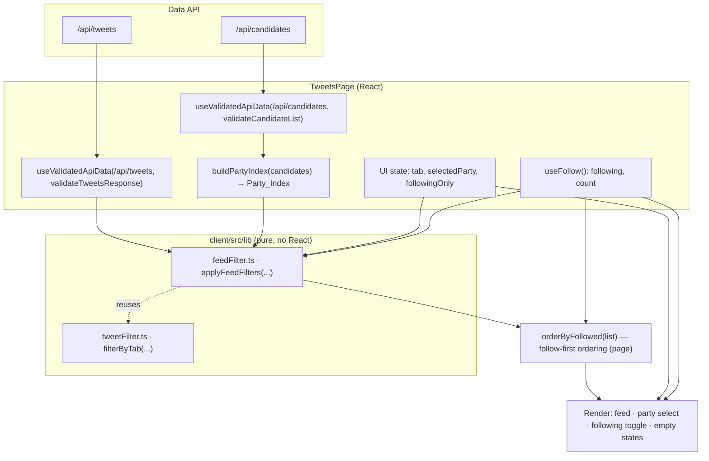

# Design Document

## Overview

This feature adds two composable filtering controls to the Tweets section — a **Party_Filter** and a **Following_Filter** — that work alongside the existing tab filter. Today `TweetsPage` fetches `/api/tweets`, selects posts by tab with the pure `filterByTab`, and floats followed candidates to the top via `orderByFollowed`. It offers no way to narrow the feed by party or to show "only candidates I follow."

The core difficulty is that a `Tweet` carries no party; party lives on the `Candidate` record (`party: Party`). To filter posts by party, the page must also load `/api/candidates`, build a `candidateId → Party` map (the **Party_Index**), and resolve each post's party through that map. A post whose `candidateId` is missing, null, or absent from the index is an **Unresolved_Post** and is excluded whenever a specific party is selected or the following-only filter is on.

Following the convention established by `filterByTab` (a pure module in `client/src/lib/` with a fast-check property test), the combined selection logic is extracted into a new pure module, `client/src/lib/feedFilter.ts`. It depends only on its explicit parameters, mutates nothing, and is importable without React — so it can be property-tested exactly the way `tweetFilter.ts` is. `TweetsPage` becomes a thin shell: it fetches both endpoints, owns the filter UI state, builds the Party_Index, calls the pure module, applies the existing follow-ordering, and renders the appropriate empty state.

### Scope and requirements traceability

| Area | Requirements |
| --- | --- |
| Party filter control (options, default, sentinel, a11y label) | 1.1–1.7 |
| Resolving a post's party through the Party_Index | 2.1–2.4 |
| Following-only toggle control and behavior | 3.1–3.7 |
| Following-only when the user follows no one | 4.1–4.5 |
| Combining party + following + tab, order, immutability | 5.1–5.8 |
| Empty-result and no-follows messaging | 6.1–6.4 |
| Pure, testable filtering module | 7.1–7.7 |

### Key design decisions

- **One pure function for the intersection, UI owns ordering.** `applyFeedFilters` computes the filtered subset (tab ∧ party ∧ following) preserving input order. The follow-first *ordering* (`orderByFollowed`, Req 5.7) stays in the page because it depends on `count` from context and is a presentation concern, not a membership concern. This keeps the pure module's contract simple and total: filtering never reorders.
- **Reuse the proven party-select pattern.** The Party_Filter mirrors `CandidatesList`: a `<select>` with an `"all"` sentinel, parties derived with `useMemo`, and an accessible `label.visually-hidden` + `htmlFor` (Req 1.1, 1.7). This keeps the two party filters visually and behaviorally consistent.
- **Party_Index built on the client from loaded candidates.** No new endpoint; `/api/candidates` already exists and is validated by `validateCandidateList`. The index is a `Map<string, Party>`.
- **Distinct empty states.** "You follow no one" (Req 4.2, 6.3) and "no posts match these filters" (Req 6.1) are different messages with different actions, decided by the page from the filter state and the result.

## Architecture



### Data flow per render

1. The page fetches `/api/tweets` and `/api/candidates` with `useValidatedApiData`. Both results flow through `AsyncContent` so loading and error states are handled uniformly.
2. From the validated candidates it builds the **Party_Index** (`Map<candidateId, Party>`) and the sorted, de-duplicated list of parties for the `<select>` options (Req 1.1).
3. UI state holds the selected tab, the selected party (`"all"` sentinel or a `Party`), and the following-only flag. Defaults: tab `recent`, party `"all"`, following-only `false` (Req 1.2, 3.2).
4. `applyFeedFilters` receives the posts, tab, selected party, following-only flag, the `Followed_Set`, and the Party_Index, and returns the filtered subset in input order (Req 5.1–5.6, 7.4).
5. When the following-only flag is off, the page applies `orderByFollowed` to float followed candidates to the top, preserving relative order within each group (Req 5.7). When the flag is on, every result already belongs to a followed candidate, so ordering is the identity.
6. The page chooses what to render: the feed, the "no posts match" empty state (Req 6.1), the "followed candidates have no posts" state (Req 4.5), or the "you follow no one" state with a link to the directory (Req 4.2, 6.3).

## Components and Interfaces

### New pure module: `client/src/lib/feedFilter.ts` (Req 7.1–7.7)

```ts
import type { Party, Tweet, TweetTab } from "../types/domain";
import { filterByTab } from "./tweetFilter";

/** Sentinel meaning "no party restriction". */
export const ALL_PARTIES = "all" as const;

/** The Party_Filter selection: a specific Party or the "all" sentinel. */
export type PartySelection = Party | typeof ALL_PARTIES;

/** Maps a candidateId to its Party. A missing key ⇒ Unresolved_Post. */
export type PartyIndex = ReadonlyMap<string, Party>;

/** Explicit inputs to the combined filter (Req 7.2). */
export interface FeedFilterInput {
  posts: readonly Tweet[];
  tab: TweetTab;
  party: PartySelection;
  followingOnly: boolean;
  followedSet: ReadonlySet<string>;
  partyIndex: PartyIndex;
}

/**
 * Return the subset of `posts` satisfying the active tab, party, and
 * following-only filters, in the same relative order as the input. Pure: no
 * mutation of any input, same output for same inputs (Req 7.1, 7.4, 5.4, 5.6).
 */
export function applyFeedFilters(input: FeedFilterInput): Tweet[];

/** Resolve a post's Party via the index, or undefined if Unresolved (Req 2.1, 2.2). */
export function resolveParty(post: Tweet, partyIndex: PartyIndex): Party | undefined;

/** Build the Party_Index from candidate records (Req 2.1). */
export function buildPartyIndex(
  candidates: readonly { id: string; party: Party }[]
): PartyIndex;

/** Distinct parties present, sorted alphabetically, each once (Req 1.1). */
export function partyOptions(
  candidates: readonly { party: Party }[]
): Party[];
```

**`applyFeedFilters` semantics.** The function composes three independent predicates over the posts and returns the survivors in input order:

- **Tab:** delegates to the existing `filterByTab` so the tab predicate is defined in exactly one place. With `party = "all"` and `followingOnly = false`, the output is identical in membership and order to `filterByTab(posts, tab)` (Req 7.5).
- **Party:** if `party === ALL_PARTIES`, every post passes (Req 1.3, 2.4, 5.2). Otherwise a post passes only when `resolveParty(post, partyIndex) === party`; an Unresolved_Post fails (Req 1.4, 1.5, 2.3, 5.5, 7.7).
- **Following:** if `followingOnly === false`, every post passes (Req 3.3, 5.3). Otherwise a post passes only when `followedSet.has(post.candidateId)`; a post whose candidate is unknown or unfollowed fails, and an empty `followedSet` yields zero posts rather than an error (Req 3.4, 3.7, 4.1, 7.6).

A post is included only when it satisfies all three (Req 5.1). The implementation reads from a fresh array (e.g. a single `filter` pass over `filterByTab`'s output) and never writes to `posts`, `followedSet`, or `partyIndex` (Req 5.6, 7.1).

**`resolveParty`.** Returns `partyIndex.get(post.candidateId)`. A `candidateId` that is empty/absent or not a key returns `undefined`, classifying the post as Unresolved (Req 2.2). Because the index is a `Map`, lookup is O(1).

### Changed component: `client/src/pages/TweetsPage.tsx`

The page gains a second fetch, two pieces of filter state, the Party_Index, and the new controls. Its responsibilities:

- Fetch `/api/candidates` with `validateCandidateList` in addition to `/api/tweets`. Candidates are needed only for the Party_Index and the party options; a candidates error should not blank the whole feed, so the page treats missing candidates as an **empty index** (every post Unresolved) and still renders the tweets feed and controls. The party `<select>` then offers only "All parties" (Req 1.6), which is the correct degenerate behavior.
- Hold `tab: TweetTab` (default `recent`), `selectedParty: PartySelection` (default `ALL_PARTIES`), and `followingOnly: boolean` (default `false`) in `useState` (Req 1.2, 3.2).
- Derive `followedSet = new Set(following)` and the party options with `useMemo`.
- Compute `const filtered = applyFeedFilters({ posts, tab, party: selectedParty, followingOnly, followedSet, partyIndex })`, then `const ordered = followingOnly ? filtered : orderByFollowed(filtered)` (Req 5.7, 5.8).
- Render the party `<select>` and the following-only toggle in a toolbar, reusing the `CandidatesList` label pattern.
- Select the empty-state branch (see "Empty-state decision" below).

#### Controls

**Party filter** — a `<select>` mirroring `CandidatesList`:

```tsx
<label className="visually-hidden" htmlFor="tweet-party-filter">
  Filter posts by party
</label>
<select
  id="tweet-party-filter"
  className={styles.select}
  value={selectedParty}
  onChange={(e) => setSelectedParty(e.target.value as PartySelection)}
>
  <option value="all">All parties</option>
  {partyOptions.map((p) => (
    <option key={p} value={p}>{p}</option>
  ))}
</select>
```

Options are "All parties" followed by each distinct party sorted alphabetically, each once (Req 1.1); the label is accessible (Req 1.7); with no parties present only "All parties" shows (Req 1.6).

**Following-only toggle** — a labeled checkbox:

```tsx
<label className={styles.followingToggle}>
  <input
    type="checkbox"
    checked={followingOnly}
    onChange={(e) => setFollowingOnly(e.target.checked)}
  />
  Only candidates I follow
</label>
```

The visible text and the control's accessible name both identify it as a filter for followed candidates (Req 3.1). Toggling it flips state and triggers a synchronous re-render, so the feed updates well within 500 ms (Req 3.5, 5.8, 6.2).

#### Empty-state decision (Req 4.2, 4.5, 6.1, 6.3)

After computing `ordered`, the page renders exactly one of:

1. **Follows no one.** `followingOnly && followedSet.size === 0` → message "You're not following anyone yet" with a `<Link to="/voting/candidates">` to the directory (Req 4.1, 4.2, 4.3, 6.3). Distinct from the no-match message.
2. **Followed candidates have no posts.** `followingOnly && followedSet.size > 0 && ordered.length === 0` → message "The candidates you follow have no posts here" (Req 4.5). Distinct from case 1.
3. **No posts match the filters.** `ordered.length === 0` (party and/or tab filtered everything out, following-only off or irrelevant) → message "No posts match these filters" plus at least one actionable hint, e.g. "Try 'All parties' or another tab" (Req 6.1).
4. **Feed.** Otherwise render the `ordered` posts; the empty-state message is not rendered concurrently with any post (Req 6.2).

Switching branches never resets `tab`, `selectedParty`, or `followingOnly` — they are independent state and persist across renders (Req 4.4, 6.4). When `following` changes from empty to non-empty while the toggle is on, `followedSet` changes, `applyFeedFilters` recomputes, and case 1 gives way to the feed or case 2 (Req 4.4).

### Unchanged collaborators

- `useFollow()` provides `following: string[]` and `count`; `followedSet` is derived from `following` (Req 3.4). No context change.
- `orderByFollowed` stays in the page for follow-first ordering when the toggle is off (Req 5.7).
- `filterByTab` is reused inside `applyFeedFilters`; the existing tab property (design Property 16) is unaffected.
- `TweetCard`, `PostsStatus`, `AsyncContent`, `PageHeader` are reused as-is.

## Data Models

No server or domain-type changes. The feature introduces client-only types in `feedFilter.ts`:

```ts
// Party, Tweet, TweetTab, Candidate come from client/src/types/domain.ts unchanged.

export const ALL_PARTIES = "all";                 // sentinel
export type PartySelection = Party | "all";       // Party_Filter selection
export type PartyIndex = ReadonlyMap<string, Party>; // candidateId → Party
export type FollowedSet = ReadonlySet<string>;    // followed candidateIds (from following[])

export interface FeedFilterInput {
  posts: readonly Tweet[];
  tab: TweetTab;
  party: PartySelection;
  followingOnly: boolean;
  followedSet: FollowedSet;
  partyIndex: PartyIndex;
}
```

- **Party_Index.** `Map<string, Party>` keyed by `Candidate.id`. Built by `buildPartyIndex`; last write wins on duplicate ids (ids are expected unique). A post's `candidateId` absent from the map ⇒ Unresolved_Post (Req 2.2).
- **Followed_Set.** `Set<string>` of `candidateId`s, built from `following` (the localStorage-backed array in `FollowContext`). Read-only to the filter module (Req 5.6).
- **PartySelection.** Either a `Party` value or the literal `"all"`. The `<select>` stores exactly these strings; the `"all"` sentinel can never collide with a real party because `Party` has no `"all"` member.
- **Relationships.** `Tweet.candidateId → Candidate.id → Candidate.party`. The Party_Index materializes the second-plus-third hop so the filter needs only the post and the map.

## Correctness Properties

*A property is a characteristic or behavior that should hold true across all valid executions of a system — essentially, a formal statement about what the system should do. Properties serve as the bridge between human-readable specifications and machine-verifiable correctness guarantees.*

The combined filter (`applyFeedFilters`), the party resolution helpers (`resolveParty`, `buildPartyIndex`, `partyOptions`), and the page's follow-first ordering (`orderByFollowed`) are pure functions over data — ideal for property-based testing. The following properties were derived from the prework analysis; redundant criteria were consolidated (e.g. the party-match, all-pass, and following components of the intersection fold into a single intersection property plus the dedicated tab-equivalence and following-only properties, and the several unresolved-exclusion clauses fold into one). Non-universal criteria (fixed defaults, accessible labels, specific empty-state messages, navigation, 500 ms latency, reactivity on control change, and the module's import location) are verified by example and smoke tests in the Testing Strategy rather than by properties.

### Property 1: Filtering is the intersection of the three predicates

*For any* posts, tab, party selection, following-only flag, followed set, and party index, a post appears in `applyFeedFilters`'s result *if and only if* it satisfies all three predicates at once: it belongs to the tab, it satisfies the party selection (always, when "all parties"; otherwise its resolved party equals the selected party), and it satisfies the following filter (always, when disabled; otherwise its `candidateId` is in the followed set).

**Validates: Requirements 5.1, 1.4, 3.4**

### Property 2: Included posts preserve input order and are a faithful subset

*For any* inputs, the result is a subsequence of the input posts: every result element is one of the input posts (by identity), no post is fabricated, each qualifying post appears exactly once, and the result's relative order matches the input (the original indices of the included posts are strictly increasing).

**Validates: Requirements 5.4, 7.4**

### Property 3: All-parties with following off equals tab filtering alone

*For any* posts, tab, followed set, and party index, applying the combined filter with the "all parties" sentinel selected and the following-only flag disabled produces a result identical in membership and order to `filterByTab(posts, tab)` alone.

**Validates: Requirements 7.5, 1.3, 2.4, 5.2, 5.3**

### Property 4: A specific party excludes unresolved posts and keeps only that party

*For any* posts, tab, followed set, party index, and specific party `P` (not the sentinel), every post in the result resolves through the party index to `P`; consequently no Unresolved_Post (one whose `candidateId` is missing, null, or absent from the index) ever appears.

**Validates: Requirements 1.4, 1.5, 2.3, 5.5, 7.7**

### Property 5: Following-only yields only followed candidates, empty rather than error

*For any* posts, tab, party selection, followed set, and party index, when the following-only flag is enabled every post in the result has a `candidateId` contained in the followed set; when no otherwise-qualifying post's candidate is in the followed set (including an empty followed set) the result is an empty array and no error is raised.

**Validates: Requirements 7.6, 3.4, 3.7, 4.1**

### Property 6: Party resolution round-trips the index

*For any* list of candidates with distinct ids, building the party index and then resolving a post whose `candidateId` equals a candidate's id returns that candidate's party; resolving a post whose `candidateId` is not a key of the index (including empty or unknown ids) returns "unresolved".

**Validates: Requirements 2.1, 2.2**

### Property 7: The filter is pure — deterministic and non-mutating

*For any* inputs, `applyFeedFilters` returns a newly allocated array distinct from the input, leaves the input posts, the followed set, and the party index (and their elements) unchanged, and returns an equal result when called twice with the same inputs.

**Validates: Requirements 5.6, 7.1**

### Property 8: Party options are the distinct parties, sorted, sentinel-prefixed

*For any* list of candidates, `partyOptions` returns each party present exactly once, with no party absent and none fabricated, in ascending alphabetical order; the empty candidate list yields an empty option list (so the control shows only the "All parties" sentinel).

**Validates: Requirements 1.1, 1.6**

### Property 9: Follow-first ordering is a stable partition

*For any* list of posts and any followed set, with the following-only filter disabled the page's `orderByFollowed` output contains the same posts as its input (same multiset), places every post authored by a followed candidate ahead of every post not authored by one, and preserves the relative input order within each of those two groups.

**Validates: Requirements 5.7**

## Error Handling

- **Tweets fetch/validation failure.** `useValidatedApiData("/api/tweets", validateTweetsResponse)` surfaces network and shape-mismatch errors through `AsyncContent`, which renders them as an alert (unchanged behavior). The filter module is never called without a validated `posts` array.
- **Candidates fetch/validation failure.** Candidates feed only the Party_Index and the party options, which are secondary to showing posts. If the candidates request fails or fails validation, the page treats the Party_Index as **empty** rather than blanking the feed: every post becomes an Unresolved_Post, the party `<select>` offers only "All parties" (Req 1.6), and the tweets feed still renders. This degrades gracefully instead of turning a candidates-only problem into a total outage. (The page may optionally show a small inline note that party filtering is unavailable; this is cosmetic and not required.)
- **Unresolved posts.** Not an error condition — an expected classification. Under "All parties" they appear; under a specific party or (by candidate-membership) the following-only filter they are excluded (Req 2.3, 2.4, 5.5).
- **Empty followed set with following-only on.** Not an error — the module returns `[]` and the page shows the no-follows message with a directory link (Req 4.1, 4.2, 6.3).
- **Malformed `PartySelection` from the `<select>`.** The control only ever yields `"all"` or a `Party` string, so the value is always valid by construction; the pure module treats any value other than `"all"` as a specific-party predicate, which safely excludes everything if a bogus value ever arrived.
- **Immutability.** The module reads from `ReadonlyMap`/`ReadonlySet`/`readonly` parameter types and returns a fresh array, so callers' inputs are never corrupted (Req 5.6, 7.1).

## Testing Strategy

The combined filter and its helpers are pure functions over plain data, so they are the primary target of property-based testing — mirroring how `filterByTab` is covered in `client/src/lib/tweetFilter.test.ts`. The React page is covered by example and interaction tests for defaults, labels, empty-state messages, navigation, and reactivity, which do not vary meaningfully with input and are not suited to PBT.

### Property-based tests (library: `fast-check`, as already used in the project)

New file `client/src/lib/feedFilter.test.ts` (plus the ordering test — see below) implements Properties 1–9, each as a **single** property-based test running **at least 100 iterations** (`{ numRuns: 100 }` or higher, matching the existing tests' 200). Each test carries a comment tag in the form:

```
// Feature: tweets-filter-by-party-and-following, Property 1: Filtering is the intersection of the three predicates
```

- **Generators.** Reuse the `tweetFilter.test.ts` approach: arrays of posts with distinct ids and random `tabs` subsets; add a random `candidateId` drawn from a small pool so some map to the index and some do not (producing Unresolved_Posts). Generate a candidate pool with random parties from the `Party` union to build the index and followed sets as random subsets of the candidate ids. `PartySelection` is `fc.constantFrom("all", ...PARTIES)`.
- **Property 1 (intersection)** is checked against an independent, obviously-correct reference predicate (`post in tab ∧ party-ok ∧ following-ok`) so the test does not merely restate the implementation.
- **Property 2 (subsequence)** verifies result elements are input elements by identity, de-duplicated, with strictly increasing source indices.
- **Property 3 (tab-equivalence)** deep-equals `applyFeedFilters(all, followingOff)` against `filterByTab(posts, tab)`.
- **Property 4 (specific-party)** asserts every result resolves to `P` and no Unresolved_Post survives; generators deliberately include unresolved ids.
- **Property 5 (following-only)** asserts every result's `candidateId ∈ followedSet` and that empty/no-match returns `[]` without throwing.
- **Property 6 (resolve round-trip)** builds the index from generated candidates and checks `resolveParty` for both present and absent ids.
- **Property 7 (purity)** snapshots inputs, asserts deep-equality afterward, asserts a distinct returned reference, and asserts two calls are equal.
- **Property 8 (party options)** asserts de-duplication, alphabetical order, membership equality with the input's distinct parties, and `[]` for empty input.
- **Property 9 (stable partition)** targets `orderByFollowed`. Because that function currently lives inside `TweetsPage`, it is extracted to the pure lib (e.g. `orderByFollowed(list, followedSet)` in `feedFilter.ts` or a sibling) so it is importable without React and property-testable; the page imports it. The test asserts same-multiset, followed-first partition, and within-group order preservation.

### Example and interaction tests (library: `vitest` + `@testing-library/react`)

New file `client/src/pages/TweetsPage.test.tsx` (co-located like `HomePage.test.tsx`) covers the non-universal criteria with mocked `/api/tweets` and `/api/candidates` responses and a wrapping router + `FollowProvider`:

- Party filter defaults to "All parties" (Req 1.2) and exposes an accessible label (Req 1.7); following toggle defaults to off (Req 3.2) and exposes an accessible label (Req 3.1).
- Following-only with no follows shows the "not following anyone" message with a working directory link (Req 3.6, 4.2, 4.3, 6.3); toggle stays enabled.
- Following-only with follows that have no posts shows the distinct "followed candidates have no posts" message (Req 4.5).
- A filter combination with no matches shows the "no posts match" message plus an actionable hint (Req 6.1), distinct from the no-follows message (Req 6.3).
- Changing the party `<select>` or toggling following updates the feed in the same render, replacing an empty state with posts and never showing both at once (Req 3.5, 4.4, 5.8, 6.2); the three selections are retained across the transition and while an empty state is shown (Req 6.4, 4.4).
- With candidates present, the `<select>` lists "All parties" plus the distinct parties (spot-check of Req 1.1 at the UI level; exhaustive coverage is Property 8).

### Smoke test

- `feedFilter.ts` imports and runs without importing any React component, confirming it resides in the client lib beside `tweetFilter.ts` and is React-free (Req 7.3); a single call with representative inputs confirms the exported signature accepts exactly the specified parameters (Req 7.2).

### Coverage summary

| Requirement area | Covered by |
| --- | --- |
| 1.1, 1.6 | Property 8 (+ UI spot-check) |
| 1.2, 1.7, 3.1, 3.2 | Example tests |
| 1.3, 2.4, 5.2, 5.3, 7.5 | Property 3 |
| 1.4, 1.5, 2.3, 5.5, 7.7 | Properties 1, 4 |
| 2.1, 2.2 | Property 6 |
| 3.4, 3.7, 4.1, 7.6 | Properties 1, 5 |
| 3.5, 4.4, 5.8, 6.2 | Interaction tests |
| 3.6, 4.2, 4.3, 4.5, 6.1, 6.3, 6.4 | Example/interaction tests |
| 5.1 | Property 1 |
| 5.4, 7.4 | Property 2 |
| 5.6, 7.1 | Property 7 |
| 5.7 | Property 9 |
| 7.2, 7.3 | Smoke test |
