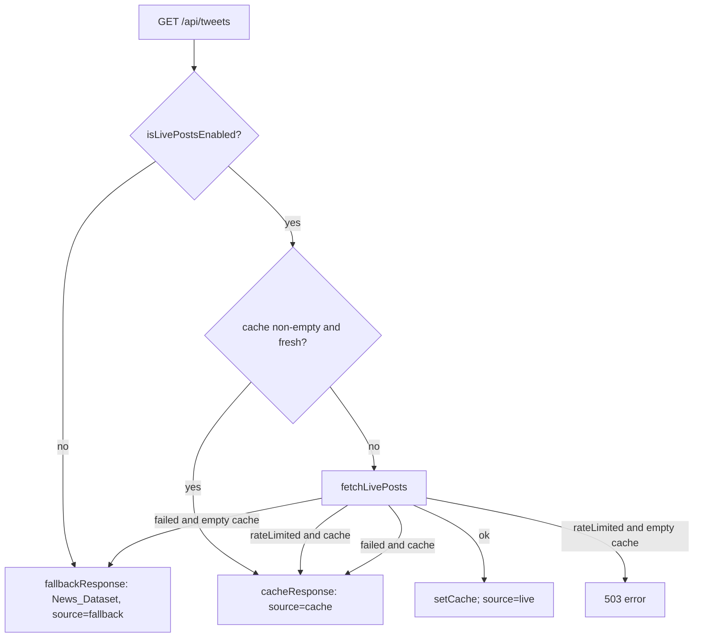

# News Section Design Document

## Overview

The Tweets section renders no content because the fallback posts dataset (`tweets` in `server/src/domain/tweets.ts`) is empty and cannot be populated: the section was built around genuine, verified x.com posts, and x.com gates post text, status IDs, and engagement counts behind authentication and a paid API. There are no verifiable x.com records to add, so every request that resolves to the fallback branch of `resolveTweets()` serves `{ posts: [], source: "fallback" }` and `TweetsPage` shows "No posts in this tab yet." on all four tabs.

This design repurposes the section as a curated candidate News feed while making the smallest change that works. The server response envelope `{ posts, source }`, the cache -> live -> fallback decision tree in `resolveTweets()`, the `fallbackResponse()` shape, and the origin indicator (`PostsStatus`) are all preserved exactly. The two things that change are:

1. The item data model: a `News_Item` (headline, outlet, url, date, one or more candidate ids, tab membership, optional neutral context) replaces the x.com-`Tweet` shape for this section.
2. The data served on the fallback branch: `server/src/domain/tweets.ts` is populated with a curated, verified static `News_Dataset` instead of an empty array.

Verification reuses the discipline already applied to candidate `stances` in `candidates.ts`: every item links to a resolvable HTTP/HTTPS source (`Verified_Source`) and is only included if it can be verified; candidates with no verifiable coverage simply contribute no items. Every non-Tweets section (candidates, issues, causes, connect, election, quiz) is untouched.

## Glossary

- **News_Item**: The curated record replacing `Tweet` for this section. Shape: `{ id: string; candidateIds: string[]; title: string; outlet: string; url: string; date: string; tabs: TweetTab[]; context?: Explain }`.
- **News_Dataset**: The curated static array served on the fallback branch of `resolveTweets()` -- the `tweets` export in `server/src/domain/tweets.ts`, repurposed to hold `News_Item[]`. The export name is kept (see Fix Implementation) so `data.ts` imports need no change.
- **Verified_Source**: A `url` that resolves over HTTP/HTTPS to a real, publicly accessible article from a reputable outlet, `.gov` page, or official campaign site. Replaces the prior "`sourceUrl` host must be `x.com`" guarantee.
- **`resolveTweets()`**: The function in `server/src/routes/data.ts` that resolves the response envelope via the cache -> live -> fallback decision tree. Unchanged by this design.
- **`fallbackResponse()`**: The helper in `server/src/routes/data.ts` that returns `{ posts: tweets, source: "fallback" }`. Unchanged in shape; now serves `News_Item[]`.
- **`filterByTab()`**: The pure function in `client/src/lib/tweetFilter.ts` that returns items whose `tabs` array contains a given tab, preserving input order.
- **`orderByFollowed()`**: The pure helper in `client/src/lib/feedFilter.ts` that stably floats followed items to the front. Adapted to `candidateIds` any-of and extended with most-recent-first date ordering within each group.
- **`applyFeedFilters()` / `buildPartyIndex()` / `resolveParty()`**: The pure, React-free filter functions in `client/src/lib/feedFilter.ts`. Adapted from a single `candidateId` to any-of over `candidateIds`.
- **Any-of matching**: A `News_Item` matches a party/follow predicate (or floats in ordering) when ANY of its `candidateIds` satisfies that predicate.
- **The four tabs**: The `TweetTab` ids `"recent" | "notable" | "needsContext" | "interactions"`, labeled in the client as "Recent News", "Notable News", "Needs Context", and "Interactions".

## Bug Details

The bug manifests when a `GET /api/tweets` request resolves to the fallback branch of `resolveTweets()` while the `News_Dataset` (`tweets`) is empty. This is the default configuration: with no `LIVE_POSTS_BEARER_TOKEN`, `isLivePostsEnabled()` returns `false`, the route serves `{ posts: [], source: "fallback" }`, and `TweetsPage` applies `filterByTab` to an empty list for every tab -- so each of Recent, Notable, Needs Context, and Interactions shows "No posts in this tab yet." The same empty result is served when a live fetch fails with an empty cache.

The control flow is correct; the defect is in the data. Under the original x.com-post design the dataset could not be populated at all, because x.com gates post text, status IDs, and engagement counts behind authentication and a paid API -- there are no verifiable x.com records to add. So the section stays empty.

Examples:

- **No credentials (default), Recent tab**: `livePostsEnabled = false`, dataset `[]`. Expected: Recent News shows at least one verified item. Actual (bug): "No posts in this tab yet."
- **No credentials, every tab**: `livePostsEnabled = false`, dataset `[]`. Expected: items partition across the four tabs by `tabs` membership. Actual (bug): all four tabs empty.
- **Live fetch fails, empty cache**: `livePostsEnabled = true`, outcome `failed`, cache empty, dataset `[]`. Expected: the curated dataset is served. Actual (bug): zero items.
- **Target state (post-fix)**: `livePostsEnabled = false`, dataset `[verified News_Items]`. The section displays the curated news.

## Hypothesized Root Cause

The root cause is a data model that cannot be populated, not a logic error. The section was modeled around genuine, verified x.com posts (`Tweet`: `authorHandle`, `likes`, `reposts`, single `candidateId`, `sourceUrl` on host `x.com`). That verification standard cannot be met: x.com requires authentication and a paid API to retrieve and verify post data, so the fallback dataset `tweets` was left as `export const tweets: Tweet[] = []`. The empty array is served verbatim by `fallbackResponse()`, which is why every fallback request yields zero posts.

The fix therefore changes the model (a `News_Item` keyed to one or more `candidateIds`, verified by a resolvable HTTP/HTTPS `url` -- the same `Verified_Source` discipline used for candidate `stances`) and populates the fallback dataset with verifiable records, while leaving `resolveTweets()` and the envelope untouched.

## Architecture

The request/response architecture is unchanged. `GET /api/tweets` calls `resolveTweets()`, which walks the same decision tree:



The only change in this graph is the payload type flowing through it: `posts` is now `News_Item[]` rather than x.com `Tweet[]`. The real data path for this feature is the fallback branch (`News_Dataset`); the live/cache branches remain wired but, under the minimal approach, serve nothing useful for news (see the tradeoff note under Data Models).

The client path is likewise preserved: `TweetsPage` fetches `/api/tweets`, validates the envelope with `shape.ts`, applies `applyFeedFilters` + `orderByFollowed`, renders through `PostsStatus` (origin indicator) and `TweetCard`.

## Components and Interfaces

- **`server/src/routes/data.ts`** (`resolveTweets`, `fallbackResponse`, `cacheResponse`): unchanged control flow and envelope. Serves `News_Dataset` on the fallback branch.
- **`server/src/domain/types.ts`**: defines the item type served by the envelope (see Data Models). `TweetsResponse` keeps `{ posts, source }` with `posts` typed as the News item.
- **`server/src/domain/tweets.ts`**: exports `tweets` (kept name), now the curated `News_Dataset`.
- **`client/src/types/domain.ts`**: compile-time mirror of the server item type; must stay in sync.
- **`client/src/lib/tweetFilter.ts`** (`filterByTab`): unchanged in contract -- still "item in tab T iff T in item.tabs".
- **`client/src/lib/feedFilter.ts`** (`resolveParty`, `applyFeedFilters`, `orderByFollowed`, `buildPartyIndex`, `partyOptions`): adapted to any-of over `candidateIds` and date ordering (see Filter/Ordering Adaptation).
- **`client/src/lib/shape.ts`**: runtime validators adapted to the News item shape.
- **`client/src/pages/TweetsPage.tsx`**: tab labels become "Recent News" / "Notable News" / "Needs Context" / "Interactions"; wiring to filters/ordering preserved.
- **`client/src/features/tweets/TweetCard.tsx`**: renders `title`, `outlet`, `date`, `url`, and `context` instead of `authorHandle` / `likes` / `reposts` / `text`.
- **`client/src/components/PostsStatus.tsx`**: unchanged origin indicator (Live / Cached / Fallback) and usage/attribution notice.

## Data Models

The `Tweet` shape is replaced for this section by a News item. The `TweetTab` union ids are kept so filtering code needs no re-keying; only the client labels change.

```typescript
// server/src/domain/types.ts  (mirrored in client/src/types/domain.ts)

export type TweetTab = "recent" | "notable" | "needsContext" | "interactions";

/** A curated, verified news item relevant to one or more candidates. */
export interface News_Item {
  id: string;
  /** One or more candidate ids (no duplicates), each matching a Candidate.id. */
  candidateIds: string[];
  /** The article headline. */
  title: string;
  /** The publisher / source name, e.g. "Boston Globe". */
  outlet: string;
  /** Resolvable HTTP/HTTPS link to the article (Verified_Source). */
  url: string;
  /** Publication date, ISO 8601. */
  date: string;
  /** Which tabs this item appears in (one or more). */
  tabs: TweetTab[];
  /** Optional neutral clarification shown on the Needs Context tab. */
  context?: Explain;
}

/** Envelope returned by GET /tweets: unchanged shape, News items inside. */
export interface TweetsResponse {
  posts: News_Item[];
  source: PostsSource;
}
```

Notes:

- **Dropped fields**: `authorName`, `authorHandle`, `text`, `likes`, `reposts`, `inReplyTo`, `sourceUrl`, and the single `candidateId` are removed from the item served in this section.
- **Label vs id**: tab ids stay `"recent" | "notable" | "needsContext" | "interactions"`; the UI labels become "Recent News" / "Notable News" / "Needs Context" / "Interactions".
- **Envelope preserved**: `TweetsResponse` remains `{ posts, source }` with `source: PostsSource` (`"live" | "cache" | "fallback"`).
- **Server/client sync**: `server/src/domain/types.ts` and `client/src/types/domain.ts` must declare the same item shape.
- **Tradeoff (live pipeline dead-but-present)**: the x.com live-fetch provider pipeline (`server/src/posts/provider.ts`, `server/src/posts/cache.ts`) is retained as-is under the minimal approach. With no credentials it is disabled (the common case), and even when enabled it fetches x.com posts, which do not map to the News item shape -- so the live/cache branches effectively serve nothing useful for the news feed. The fallback branch is the real data path. We accept this dead-but-present code to keep the change surgical and avoid touching `resolveTweets()`; a later cleanup could retire or repurpose the provider.

## Filter/Ordering Adaptation

All three adaptations move from a single `post.candidateId` to any-of over `item.candidateIds`. The functions stay pure and React-free and mutate none of their inputs.

- **`resolveParty(item, partyIndex)`**: returns a `Party` when ANY id in `item.candidateIds` resolves through `partyIndex`; otherwise `undefined` (Unresolved). Precise predicate: `item.candidateIds.some(id => partyIndex.has(id))`, returning the party of the first resolving id. For the party filter, an item passes a specific party `P` iff `item.candidateIds.some(id => partyIndex.get(id) === P)`.
- **`applyFeedFilters` following-only**: an item passes iff `!followingOnly || item.candidateIds.some(id => followedSet.has(id))`. An empty `followedSet` with `followingOnly` on yields `[]` (empty feed, not an error).
- **`orderByFollowed(list, followedSet)`**: stable partition where an item is "followed" iff `item.candidateIds.some(id => followedSet.has(id))`. Within each of the two groups (followed, rest), items are ordered most-recent-first by `date` (descending ISO 8601 comparison). The function returns a freshly allocated array and does not mutate `list`.

`filterByTab` is unchanged in semantics: `item in tab T iff T in item.tabs`.

## Expected Behavior

After the fix, a request that resolves to the fallback branch (the default, no-credentials case, and the failed-fetch-with-empty-cache case) serves a non-empty curated `News_Dataset`, so at least the Recent News tab is populated instead of showing the empty state (Req 2.1, 2.2). Every served item is a `Verified_Source`: non-empty `title`/`outlet`/`url`/`date`, `date` a valid ISO 8601 string, `url` resolvable over HTTP/HTTPS, and `candidateIds` non-empty, duplicate-free, with every id matching a real candidate in `candidates.ts` (Req 2.3, 2.4). Candidates with no verifiable coverage contribute nothing -- no placeholder, no fabrication (Req 2.5).

The four tabs keep tab-membership semantics (`item in tab T iff T in item.tabs`); Interactions shows items with `candidateIds.length >= 2`, and Needs Context renders each item's neutral `context` (Req 2.6). The party filter, the follow filter, and followed-first ordering use any-of over `candidateIds`, with an empty follow set yielding an empty feed and items ordered most-recent-first within each group (Req 2.7, 2.8). The `{ posts, source }` envelope, the decision tree, the origin indicator, and all non-Tweets sections are unchanged (Req 3.1-3.6).

## Correctness Properties

*A property is a characteristic or behavior that should hold true across all valid executions of a system -- essentially, a formal statement about what the system should do. Properties serve as the bridge between human-readable specifications and machine-verifiable correctness guarantees.*

### Property 1: Bug Condition -> fixed (non-empty, verified fallback)

*For all* requests that resolve to the fallback branch with live posting disabled, the served envelope has `source === "fallback"` and `posts.length >= 1`, at least one served item has `"recent"` in its `tabs` (so the Recent News tab is populated), and *for all* served items the item is a Verified_Source: `title`, `outlet`, `url`, and `date` are non-empty, `date` is a valid ISO 8601 string, `url` parses as an `http`/`https` URL, and `candidateIds` is non-empty, has no duplicates, and every id matches a real candidate in `candidates.ts`.

**Validates: Requirements 2.1, 2.2, 2.3, 2.4, 2.5**

### Property 2: Preservation

*For all* requests, the response is the `{ posts, source }` envelope resolved by the cache -> live -> fallback decision tree; the origin indicator renders the Live / Cached / Fallback label for the served `source`; tab-membership filtering, the party filter, and the follow filter remain available; and every non-Tweets section behaves exactly as before.

**Validates: Requirements 3.1, 3.2, 3.3, 3.4, 3.6**

### Property 3: Interactions tab consistency

*For all* datasets, an item is shown on the Interactions tab iff `"interactions"` is a member of its `tabs` AND `candidateIds.length >= 2`. Equivalently, the curated dataset maintains the invariant that `"interactions" in item.tabs` implies `item.candidateIds.length >= 2`, so tab membership and the multi-candidate rule agree.

**Validates: Requirements 2.6**

### Property 4: Any-of filters and ordering

*For all* datasets, follow sets, and party selections, the party filter keeps an item iff ANY of its `candidateIds` resolves to the selected party; the follow filter keeps an item iff ANY of its `candidateIds` is followed (empty follow set yields an empty feed); and `orderByFollowed` floats an item ahead iff ANY of its `candidateIds` is followed, with items within each group ordered most-recent-first by `date`. All three are pure and mutate no input.

**Validates: Requirements 2.7, 2.8, 3.4**

## Fix Implementation

Files to change:

- **`server/src/domain/types.ts`**: define the `News_Item` shape and point `TweetsResponse.posts` at it (repurpose the `Tweet` usage for this section). Keep `TweetTab` ids and the `{ posts, source }` envelope.
- **`server/src/domain/tweets.ts`**: populate the curated, verified `News_Dataset`. Keep the exported name `tweets` (minimal: `data.ts`'s `import { tweets }` stays unchanged) -- we deliberately keep the name rather than rename to avoid touching the import in `data.ts`.
- **`client/src/types/domain.ts`**: mirror the `News_Item` shape so server and client stay in sync.
- **`client/src/lib/tweetFilter.ts`**: `filterByTab` keeps its contract (now over `News_Item`); re-type to the News item.
- **`client/src/lib/feedFilter.ts`**: adapt `resolveParty`, `applyFeedFilters` (following-only), and `orderByFollowed` from single `candidateId` to any-of over `candidateIds`, and add most-recent-first date ordering within each group; keep functions pure/React-free.
- **`client/src/pages/TweetsPage.tsx`**: relabel the four tabs to "Recent News" / "Notable News" / "Needs Context" / "Interactions" and render News cards.
- **`client/src/features/tweets/TweetCard.tsx`**: render `title`/`outlet`/`date`/`url`/`context` instead of handle/likes/reposts/text.
- **`client/src/lib/shape.ts`**: adapt the runtime validators to the `News_Item` shape and envelope.

Explicit non-changes: the `resolveTweets()` decision tree, `fallbackResponse()` shape, the `PostsStatus` origin indicator and attribution notice, and all non-Tweets routes/sections (candidates, issues, causes, connect, election, quiz).

## Error Handling

- **Empty follow set with following-only on**: yields an empty feed, not an error (Req 2.7); `TweetsPage` renders the "you follow no one" empty state.
- **Unresolved party**: an item whose `candidateIds` resolve to no party is excluded while a specific party is selected (any-of `resolveParty` returns `undefined`).
- **Invalid payload**: `shape.ts` validators reject a payload whose `posts` do not match the News item shape (missing/renamed/wrong-typed fields, out-of-union `source`, non-array `candidateIds`) with a human-readable type-mismatch error, so the UI surfaces the error instead of rendering bad data.
- **Live/cache branch with no usable news**: under the dead-but-present live pipeline, a failed fetch with an empty cache falls through to the populated `News_Dataset` (Req 2.2); the rate-limited-with-empty-cache branch continues to return 503 unchanged.
- **Dataset discipline**: dataset size kept within 0..100; no fabricated headlines, outlets, dates, or URLs -- unverifiable candidates contribute nothing (Req 2.5, 3.5).

## Testing Strategy

The feed, filters, ordering, and dataset validity are pure/data concerns with meaningful input variation, so property-based tests apply (minimum 100 iterations each, tagged `Feature: news-section, Property {n}`). A property-based testing library already in use in the repo is reused; properties are not implemented from scratch. Example-based unit tests cover concrete rendering and envelope shape.

- **Exploratory bug-condition check**: assert that with live posting disabled the fallback branch serves a non-empty `News_Dataset` and that the Recent News tab is populated (`source === "fallback"`, `posts.length >= 1`, at least one item with `"recent"` in `tabs`). This encodes Property 1 and fails on the unfixed (empty) dataset.
- **Fix checking**: once the dataset is populated, the same property passes; add a dataset property test asserting Verified_Source for every item -- `url` parses as `http`/`https`, non-empty `title`/`outlet`/`url`/`date` (valid ISO 8601), `candidateIds` non-empty, unique, and all resolving to real candidates, and dataset size within 0..100. This REPLACES the prior x.com-host + finite-non-negative `likes`/`reposts` assertions.
- **Preservation checking**: reuse/adapt the existing client preservation property test for tab membership (`filterByTab`), followed-first ordering (`orderByFollowed`, now any-of + date), and the origin indicator; adapt its generators to the News item shape and any-of semantics. Assert the envelope and decision tree are unchanged and non-Tweets sections are unaffected (Property 2).
- **Interactions/any-of properties**: property tests for Property 3 (interactions-tab consistency) and Property 4 (any-of party/follow/order).

Existing x.com-specific tests that MUST be updated or retired because the item shape changed:

- `server/src/domain/tweets.property.test.ts` -- rewrite: assert Verified_Source (url http/https-resolvable, candidateIds validity, 0..100 bounds) INSTEAD of `sourceUrl` host `x.com` and `likes`/`reposts`.
- `server/src/routes/data.emptyFallbackBugCondition.property.test.ts` -- update to assert a non-empty verified `News_Dataset` on the fallback branch rather than the empty-dataset bug condition.
- `client/src/pages/genuineXPosts.preservation.property.test.tsx` and any `genuineXPosts.*` tests -- retire or rewrite against the News item shape and any-of semantics (drop handle/likes/reposts assertions).
- `server/src/posts/provider.*` tests -- the handle-based exploration/mapping tests tied to x.com post shape are retired or reduced, since the live pipeline is dead-but-present for news; keep only what still verifies the preserved decision tree.
